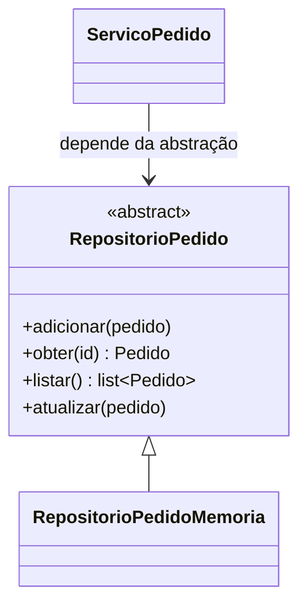

# Capítulo 16 — O sistema precisa lembrar

!!! info "Situação da Empresa"

    O Módulo 4 terminou bem: pagamento, entrega e notificação têm cada um a sua factory, e o `ServicoPedido` monta o fluxo com colaboradores injetados. O gerente viu a demonstração, gostou, e na saída fez uma pergunta que ninguém esperava.

    "Ótimo. Mas amanhã de manhã a atendente precisa abrir o pedido 12 de ontem para ver em que pé ele está. Onde ele fica?"

    A resposta honesta era desconfortável: em lugar nenhum. O pedido só existe enquanto o script que o criou continua rodando.

Até aqui, todo objeto do nosso sistema nasce e morre dentro de um programa. Produtos são criados no início do script, pedidos são passados de função em função, e quando o programa termina, tudo desaparece. Para demonstrar o fluxo, isso bastava. Para uma loja de verdade, não.

Este capítulo não vai ligar um banco de dados ainda. Primeiro precisamos responder uma pergunta mais básica, que vem antes da tecnologia: **como o resto do sistema pede um pedido que já existe?**

---

## O problema, concretamente

Olhe como o fluxo de compra funciona hoje:

```python
pedido = maria.finalizar_compra()

servico_pedido.pagar(pedido, maria)
servico_pedido.despachar(pedido, maria)
```

Quem chama o serviço **carrega o objeto `Pedido`** de uma operação para a outra. Isso só funciona porque tudo acontece no mesmo lugar, no mesmo instante. Agora imagine o pagamento acontecendo hoje e o despacho amanhã, em outra execução do programa:

- o objeto `pedido` não existe mais;
- o serviço não tem como recebê-lo, porque quem o chamaria não o tem;
- nem existe um jeito de dizer *qual* pedido queremos, porque o `Pedido` não tem identidade — é só um objeto na memória.

Dois problemas diferentes aparecem aqui, e vale separá-los:

1. **Identidade.** Como nos referimos a "o pedido 12"?
2. **Guarda.** Quem sabe onde os pedidos ficam e como recuperá-los?

---

## 🧠 Pense

Se a atendente quer ver o pedido 12, quem deveria saber **onde** ele está guardado: o `Pedido`? O `ServicoPedido`? Um objeto novo?

Antes de continuar, pense em uma regra do curso: o `Pedido` cuida de itens, estado e regras de transição. Ele precisa saber que existe um banco de dados para fazer isso?

---

## Identidade: o pedido ganha um número

Um objeto da memória é identificado pela referência. Um pedido que sobrevive ao programa precisa de algo mais durável: um **identificador**. `Produto` e `Pedido` ganham um `id`:

```python title="ecommerce/pedido.py" linenums="1" hl_lines="3 6-11"
class Pedido:

    def __init__(self) -> None:
        self._id: int | None = None
        # ... itens, status, pagamento, cupom, entrega ...

    @property
    def id(self) -> int | None:
        return self._id

    def atribuir_id(self, id: int) -> None:
        # A identidade e definida uma unica vez, por quem guarda o pedido.
        if self._id is not None:
            raise ValueError("Pedido ja possui identidade")
        self._id = id
```

O `id` começa como `None`: um pedido recém-criado ainda não foi guardado em lugar nenhum, portanto ainda não tem número. Quem o atribui é **quem guarda** o pedido — o mesmo lugar que garante que dois pedidos nunca recebam o mesmo número. O `Produto` ganha exatamente a mesma estrutura:

```python title="ecommerce/produto.py" linenums="1" hl_lines="8 10-18"
    def __init__(
        self, nome: str, preco: float, quantidade_estoque: int, categoria: Categoria
    ) -> None:
        self.nome = nome
        self.preco = preco
        self.quantidade_estoque = quantidade_estoque
        self.categoria = categoria
        self._id: int | None = None

    @property
    def id(self) -> int | None:
        return self._id

    def atribuir_id(self, id: int) -> None:
        # A identidade e definida uma unica vez, por quem guarda o produto.
        if self._id is not None:
            raise ValueError("Produto ja possui identidade")
        self._id = id
```

!!! info "🏗️ Decisão de Projeto — quem decide o `id`?"

    Existem duas alternativas comuns:

    | Alternativa | Vantagem | Desvantagem |
    |---|---|---|
    | O próprio objeto gera o `id` (por exemplo, um UUID) | Não depende de ninguém para existir completo | Número difícil de falar ao telefone; o domínio passa a conhecer uma regra de geração |
    | Quem guarda o objeto atribui o `id` | Número sequencial simples; a regra fica junto de quem garante a unicidade | O objeto passa um tempo sem `id` |

    Escolhemos a segunda. Um pedido sem `id` é um pedido ainda não guardado, e isso é uma informação útil. O método `atribuir_id` só funciona uma vez, para impedir que alguém "troque" a identidade de um objeto existente.

---

## O que é um repositório

Precisamos de um lugar com uma única responsabilidade: **guardar e devolver objetos de domínio**. O resto do sistema fala com ele como se fosse uma coleção — "adicione este pedido", "me dê o pedido 12" — sem saber o que existe por trás.

!!! important "💡 Conceito — Repository"

    Um **repositório** (*Repository*) é um objeto que se comporta como uma coleção de entidades de domínio. Quem o usa pede e entrega objetos de domínio — `Pedido`, `Produto` — e nunca vê como eles são armazenados.

    O contrato do repositório fala a linguagem do domínio (`obter`, `adicionar`, `listar`), não a linguagem do armazenamento (tabelas, linhas, arquivos). Por isso ele é a fronteira entre o que o sistema *é* e onde ele *guarda* as coisas.

O Repository é um **padrão de projeto**, como o Strategy e o Factory Method: um nome conhecido para uma solução que se repete. Quem encontrar "repositório" em outro projeto, em qualquer linguagem, vai reconhecer o papel.

Isso é o mesmo movimento que fizemos várias vezes no curso: separar o que **muda** (onde e como guardar) do que **fica** (o que o sistema precisa fazer). Primeiro definimos o contrato, como em `EstrategiaDesconto` e `Pagamento`.



---

## O contrato

```python title="ecommerce/repositorio_pedido.py" linenums="1"
class PedidoNaoEncontradoError(Exception):
    pass


class RepositorioPedido(ABC):

    @abstractmethod
    def adicionar(self, pedido: Pedido) -> None:
        """Guarda um pedido novo e atribui a ele uma identidade."""

    @abstractmethod
    def obter(self, id: int) -> Pedido: ...

    @abstractmethod
    def listar(self) -> list[Pedido]: ...

    @abstractmethod
    def atualizar(self, pedido: Pedido) -> None:
        """Registra as mudancas feitas em um pedido que ja foi guardado."""
```

Quatro operações, todas no vocabulário do domínio. Pedir um pedido que não existe é um erro específico do domínio — `PedidoNaoEncontradoError` — e não um `KeyError` ou algo que vaze a forma como guardamos os dados.

`RepositorioProduto` segue o mesmo desenho, com `ProdutoNaoEncontradoError`: as mesmas quatro operações (`adicionar`, `obter`, `listar`, `atualizar`), trocando `Pedido` por `Produto`. Por ser uma repetição direta, o código está só em `repositorio_produto.py`, na pasta do capítulo.

!!! warning "⚠️ Erro comum — um repositório que devolve linhas"

    Um repositório que devolve dicionários, tuplas ou linhas de banco (`{"id": 12, "status": "pago"}`) parece prático, mas empurra para quem o usa a tarefa de interpretar esses dados — e de saber como eles foram guardados. O contrato do repositório deve entregar **objetos de domínio completos**. Quem pede um `Pedido` recebe um `Pedido`.

---

## A primeira implementação: memória

Ainda não vamos usar banco de dados. A primeira implementação do contrato é a mais simples possível: um dicionário.

```python title="ecommerce/repositorio_pedido_memoria.py" linenums="1"
class RepositorioPedidoMemoria(RepositorioPedido):

    def __init__(self) -> None:
        self._pedidos: dict[int, Pedido] = {}
        self._proximo_id = 1

    def adicionar(self, pedido: Pedido) -> None:
        pedido.atribuir_id(self._proximo_id)
        self._pedidos[self._proximo_id] = pedido
        self._proximo_id += 1

    def obter(self, id: int) -> Pedido:
        if id not in self._pedidos:
            raise PedidoNaoEncontradoError(f"Pedido {id} nao encontrado")
        return self._pedidos[id]

    def listar(self) -> list[Pedido]:
        return list(self._pedidos.values())

    def atualizar(self, pedido: Pedido) -> None:
        if pedido.id is None or pedido.id not in self._pedidos:
            raise PedidoNaoEncontradoError("Pedido nunca foi adicionado")
        self._pedidos[pedido.id] = pedido
```

O `RepositorioProdutoMemoria` é a mesma classe, com um dicionário de produtos (`repositorio_produto_memoria.py`, na pasta do capítulo).

Quem hoje guarda os pedidos? Um `dict`. Amanhã, outra coisa — e o resto do sistema não vai perceber.

??? question "Por que começar pela implementação em memória?"

    Porque ela nos permite resolver **o desenho** antes de resolver **a tecnologia**. Com o contrato e uma implementação trivial, já dá para reescrever o serviço e testar tudo. A decisão de usar banco de dados fica para o capítulo seguinte, e quando ela chegar, o resto do sistema já vai estar pronto para recebê-la.

    A implementação em memória continua útil depois: ela é perfeita para testes rápidos.

---

## Usando o repositório no serviço

O `ServicoPedido` do Capítulo 15 recebia um objeto `Pedido` pronto. Agora ele recebe o **repositório** (injeção por construtor, como todos os outros colaboradores) e as operações passam a pedir um número:

```python title="ecommerce/servico_pedido.py" linenums="1" hl_lines="3 11-14 25-26"
class ServicoPedido:

    def __init__(
        self,
        repositorio_pedido: RepositorioPedido,
        criador_pagamento: CriadorPagamento,
        expedidor: Expedidor,
        servico_notificacao: ServicoNotificacaoPedido,
    ) -> None:
        # ...

    def finalizar_compra(self, cliente: "Cliente") -> "Pedido":
        pedido = cliente.finalizar_compra()
        self._repositorio_pedido.adicionar(pedido)
        return pedido

    def pagar(self, pedido_id: int, cliente: "Cliente", forma=FormaPagamento.PIX, **dados) -> None:
        pedido = self._repositorio_pedido.obter(pedido_id)
        pedido.confirmar_pagamento(self._criador_pagamento, forma, **dados)
        self._repositorio_pedido.atualizar(pedido)
        self._servico_notificacao.pedido_pago(pedido, cliente)

    def despachar(self, pedido_id: int, cliente: "Cliente") -> Entrega:
        pedido = self._repositorio_pedido.obter(pedido_id)
        entrega = self._expedidor.despachar(pedido)
        self._repositorio_pedido.atualizar(pedido)
        self._servico_notificacao.pedido_enviado(pedido, cliente)
        return entrega
```

O padrão de cada operação é o mesmo e vale memorizar:

1. **obter** o objeto pelo `id`;
2. executar a regra de negócio (que mora no objeto);
3. **atualizar** o repositório;
4. fazer o que mais for preciso (notificar).

Na raiz de composição, um repositório novo entra na lista de peças montadas:

```python
repositorio_produto = RepositorioProdutoMemoria()
repositorio_pedido = RepositorioPedidoMemoria()
servico_pedido = ServicoPedido(
    repositorio_pedido=repositorio_pedido,
    criador_pagamento=CriadorPagamento(),
    expedidor=ExpedidorLojaCentral(),
    servico_notificacao=ServicoNotificacaoPedido(CriadorNotificacao()),
)

pedido = servico_pedido.finalizar_compra(maria)
servico_pedido.pagar(pedido.id, maria)       # só o número viaja
servico_pedido.despachar(pedido.id, maria)
```

Quem chama o serviço não carrega mais o `Pedido`: só o número. Foi exatamente isso que o gerente pediu.

---

## 🔍 Análise — o `atualizar` parece sobrando

Repare em algo estranho. Na implementação em memória, `atualizar` não faz nada de útil: guarda no dicionário a **mesma referência** que já estava lá.

```python
pedido = repositorio.obter(12)
pedido.cancelar()                  # o objeto já é o mesmo que está no dicionário
repositorio.atualizar(pedido)      # ...então isto é redundante
```

Se você tirar a chamada a `atualizar`, os testes deste capítulo continuam passando. Seria tentador concluir que ela é desnecessária.

Não é. Ela é necessária para **qualquer implementação que copie os dados** — como um banco de dados. No próximo capítulo você vai ver o que acontece quando alguém esquece o `atualizar`. Por ora, mantenha o hábito: o contrato diz que, depois de mudar um objeto, você avisa o repositório.

---

## Testando o contrato

Os testes do repositório não testam "o dicionário". Eles testam o **contrato**: o que qualquer repositório de pedidos precisa fazer.

```python title="tests/test_repositorio_pedido.py" linenums="1"
class TestRepositorioPedido:

    def test_adicionar_atribui_identidade(self, repositorio) -> None:
        pedido = _pedido()
        repositorio.adicionar(pedido)
        assert pedido.id is not None

    def test_obter_inexistente_falha(self, repositorio) -> None:
        with pytest.raises(PedidoNaoEncontradoError):
            repositorio.obter(99)

    def test_atualizar_registra_a_mudanca_de_status(self, repositorio) -> None:
        pedido = _pedido()
        repositorio.adicionar(pedido)
        pedido.cancelar()
        repositorio.atualizar(pedido)
        assert repositorio.obter(pedido.id).status == "cancelado"
```

Nenhum teste menciona `RepositorioPedidoMemoria` — só a fixture `repositorio`, que hoje devolve a implementação em memória. Escrevemos assim de propósito: no próximo capítulo, **os mesmos testes** vão rodar contra outra implementação.

```bash
$ pytest tests/
```

??? tip "137 testes passando"

    Catorze testes novos: contrato dos repositórios de produto e de pedido (adicionar, obter, listar, atualizar, erros de inexistência), unicidade da identidade, e o `ServicoPedido` guardando e recuperando pedidos pelo repositório. Os testes do serviço agora também verificam que pedir um `id` inexistente falha com `PedidoNaoEncontradoError`.

---

## 🧩 Aplicando ao Projeto Financeiro

Seu Projeto Financeiro tem lançamentos, contas e categorias — e, até aqui, tudo vive em listas dentro de objetos ou em variáveis do script.

Faça o mesmo movimento deste capítulo:

1. Dê identidade a `Lancamento` (e a `Conta`, se fizer sentido para você).
2. Modele a interface `RepositorioLancamento` com as operações que o seu sistema realmente usa. Pergunte-se: preciso de `listar_por_conta(conta_id)` ou `listar_por_periodo(inicio, fim)`? Essas consultas pertencem ao contrato, porque falam a linguagem do domínio.
3. Crie a implementação em memória e reescreva o serviço que importa lançamentos para receber o repositório por construtor.

Documente: que consulta do seu sistema foi a mais difícil de colocar no contrato? Ela deveria mesmo estar no repositório?

---

## 🎯 Exercícios

**Nível 1.** Adicione ao `RepositorioProduto` e à implementação em memória o método `listar_por_categoria(nome: str)`. Escreva o teste do contrato.

**Nível 2.** Crie `RepositorioClienteMemoria`. O `Cliente` ainda não tem identidade: decida se `id` é a melhor chave ou se o e-mail serve, e justifique.

**🚀 Desafio.** O `ServicoPedido` repete o ciclo "obter → agir → atualizar" em duas operações. Isso é duplicação ou é o desenho certo? Defenda sua posição antes de decidir se vale extrair algo.

---

## 📌 Resumo

- Um objeto na memória é identificado pela referência; um objeto que sobrevive ao programa precisa de **identidade** (`id`)
- O `id` é atribuído por quem guarda o objeto, uma única vez
- Um **repositório** se comporta como uma coleção de objetos de domínio: `adicionar`, `obter`, `listar`, `atualizar`
- O contrato fala a linguagem do domínio e entrega **objetos completos**, nunca linhas ou dicionários
- A primeira implementação é em memória: resolvemos o desenho antes da tecnologia
- O serviço recebe o repositório por injeção e passa a trabalhar com `pedido_id`
- `atualizar` parece redundante em memória, mas faz parte do contrato

## O que mudou no sistema

- ✔ `Produto` e `Pedido` têm identidade (`id`, atribuído uma vez)
- ✔ `RepositorioProduto` e `RepositorioPedido` definem o contrato; existem as versões em memória
- ✔ `ServicoPedido` recebe o repositório e opera por `pedido_id`
- ✔ Os testes de contrato são independentes de implementação
- ❌ Reiniciar o programa ainda apaga tudo
- ❌ Coordenação e domínio ainda moram no mesmo pacote

## O que vem a seguir

O desenho está pronto, mas o gerente ainda não ficou satisfeito: o pedido 12 continua desaparecendo quando o programa termina. Para guardar de verdade, vamos usar um banco de dados. E o que torna o desenho deste capítulo valioso será testado agora: se estiver certo, trocar a memória por um banco **não deve mudar o serviço nem o domínio**. Esse é o desafio do próximo capítulo.
