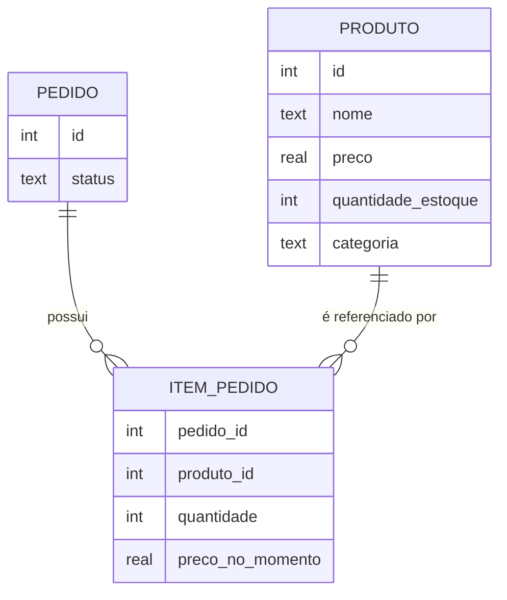

# Capítulo 17 — Guardando de verdade

!!! info "Situação da Empresa"

    A atendente já consegue pedir o pedido 12 pelo número, e o serviço o encontra sem ninguém precisar carregá-lo de uma chamada para outra. O gerente testou numa terça-feira à tarde, achou ótimo — e na quarta de manhã voltou.

    "O pedido 12 sumiu. Reiniciaram o servidor à noite."

    Claro que sumiu. O nosso repositório guarda tudo num dicionário, e o dicionário morre com o programa. Chegou a hora de guardar em um lugar que sobreviva.

O Capítulo 16 terminou com uma aposta: se o desenho estiver certo, trocar a memória por um banco de dados **não vai mudar o serviço nem o domínio**. Este capítulo é o teste dessa aposta.

Vamos usar o **SQLite**: um banco de dados completo que vem com o Python (módulo `sqlite3`), guarda tudo em um único arquivo e não exige instalar nada. Para aprender onde fica a fronteira entre domínio e armazenamento, é a ferramenta ideal.

---

## O que precisamos guardar

Antes de escrever uma linha de SQL, a pergunta é de modelagem: **o que, exatamente, vai para o banco?**

| Objeto | Vai para o banco? | Observação |
|---|---|---|
| `Produto` | Sim | `nome`, `preco`, `quantidade_estoque` e a categoria |
| `Pedido` | Sim | `status` e os itens |
| `ItemPedido` | Sim | `produto`, `quantidade` e o `preco_no_momento` |
| `Pagamento`, `Entrega`, `Cupom` | **Ainda não** | Ficam para depois (veja a Decisão de Projeto abaixo) |
| `Cliente` | **Ainda não** | O `Pedido` não referencia o cliente |

Note o `preco_no_momento` do item: ele é uma **cópia** do preço no instante da compra, e precisa ser guardado separadamente. Se guardássemos só o `produto_id` e lêssemos o preço do produto depois, um reajuste mudaria o valor de pedidos antigos.

!!! info "🏗️ Decisão de Projeto — o que fica de fora, e por quê"

    Persistir o `Pagamento` exige reconstruir a subclasse certa (Pix, boleto ou cartão), com os dados da forma escolhida. Persistir `Entrega` e `Cupom` tem o mesmo tipo de problema. É perfeitamente resolvível, mas mostraria a mesma ideia três vezes e esconderia o ponto central deste capítulo.

    Então limitamos o escopo **de propósito** e deixamos a dívida à vista: um pedido relido do banco volta sem `pagamento`, sem `entrega` e sem `cupom`. Preencher essa lacuna é o 🚀 Desafio no fim do capítulo.

    Vale dizer com todas as letras: **isto é um recorte didático, e não um sistema completo**. Persistimos apenas `Produto`, `Pedido` e `ItemPedido`. Um sistema de verdade guardaria **tudo**: também `Cliente`, `Carrinho`, `Pagamento`, `Entrega` e `Cupom`, e o `Pedido` passaria a referenciar o `Cliente`. Cada classe a mais traz tabelas, mapeamento (inclusive de hierarquias, como as formas de pagamento) e migrações do esquema.

    Com muitas classes persistidas, o SQL escrito à mão (um `INSERT`, um `UPDATE`, um `SELECT` e um mapeador para cada uma) fica repetitivo e fácil de errar. É nesse ponto que um **ORM** começa a compensar, e a seção "E o ORM?", mais adiante, mostra onde ele entraria sem mudar o domínio.

---

## O esquema

Um banco relacional guarda tabelas, não objetos. Precisamos de uma tabela para cada coisa que queremos guardar:

```python title="ecommerce/esquema_sqlite.py" linenums="1"
ESQUEMA = """
CREATE TABLE IF NOT EXISTS produto (
    id INTEGER PRIMARY KEY AUTOINCREMENT,
    nome TEXT NOT NULL,
    preco REAL NOT NULL,
    quantidade_estoque INTEGER NOT NULL,
    categoria TEXT NOT NULL
);

CREATE TABLE IF NOT EXISTS pedido (
    id INTEGER PRIMARY KEY AUTOINCREMENT,
    status TEXT NOT NULL
);

CREATE TABLE IF NOT EXISTS item_pedido (
    pedido_id INTEGER NOT NULL REFERENCES pedido(id),
    produto_id INTEGER NOT NULL REFERENCES produto(id),
    quantidade INTEGER NOT NULL,
    preco_no_momento REAL NOT NULL
);
"""


def criar_esquema(conexao: sqlite3.Connection) -> None:
    conexao.executescript(ESQUEMA)
```

Duas observações. Primeiro, o `id` é gerado pelo próprio banco (`AUTOINCREMENT`): é ele quem passa a garantir a unicidade, e vamos usar o valor que ele gerar para chamar `atribuir_id` no objeto. Segundo, a `categoria` ficou como um simples texto dentro de `produto`: `Categoria` só tem um nome, e uma tabela para ela seria cerimônia sem ganho.



!!! note "Sobre guardar dinheiro como `REAL`"

    Usamos `float` e `REAL` porque o restante do curso usa `float` para preços. Num sistema financeiro de verdade, o correto é trabalhar com `Decimal` ou com centavos inteiros, justamente para evitar erros de arredondamento. Mantivemos o `float` para não desviar o foco, mas fica registrado.

---

## O repositório de produtos em SQLite

Mesmo contrato do capítulo anterior. A diferença está inteira dentro da classe:

```python title="ecommerce/repositorio_produto_sqlite.py" linenums="1"
class RepositorioProdutoSQLite(RepositorioProduto):

    def __init__(self, conexao: sqlite3.Connection) -> None:
        self._conexao = conexao

    def adicionar(self, produto: Produto) -> None:
        with self._conexao:
            cursor = self._conexao.execute(
                "INSERT INTO produto (nome, preco, quantidade_estoque, categoria) "
                "VALUES (?, ?, ?, ?)",
                (produto.nome, produto.preco, produto.quantidade_estoque, produto.categoria.nome),
            )
        produto.atribuir_id(cursor.lastrowid)

    def obter(self, id: int) -> Produto:
        linha = self._conexao.execute(
            "SELECT id, nome, preco, quantidade_estoque, categoria FROM produto WHERE id = ?",
            (id,),
        ).fetchone()
        if linha is None:
            raise ProdutoNaoEncontradoError(f"Produto {id} nao encontrado")
        return self._reconstituir(linha)
```

A **conexão** chega pelo construtor — injeção de dependências, a mesma técnica do Capítulo 15. O repositório não decide qual arquivo abrir; quem monta o sistema decide. Isso permite usar `":memory:"` (um banco temporário) nos testes e um arquivo real em produção.

Os pontos que merecem atenção:

- Os `?` são **parâmetros**. Nunca monte SQL concatenando strings com valores — é o caminho aberto para a injeção de SQL.
- `with self._conexao:` abre uma **transação**: se algo falhar no meio, nada é gravado pela metade.
- `_reconstituir` é o ponto onde a **linha vira objeto** (veja a seguir).

Além de `adicionar` e `obter`, o repositório tem `listar` e `atualizar`, no mesmo estilo (um `SELECT` de todas as linhas, e um `UPDATE` que falha se o produto nunca foi guardado):

```python title="ecommerce/repositorio_produto_sqlite.py" linenums="1"
    def listar(self) -> list[Produto]:
        linhas = self._conexao.execute(
            "SELECT id, nome, preco, quantidade_estoque, categoria FROM produto ORDER BY id"
        ).fetchall()
        return [self._reconstituir(linha) for linha in linhas]

    def atualizar(self, produto: Produto) -> None:
        with self._conexao:
            cursor = self._conexao.execute(
                "UPDATE produto SET nome = ?, preco = ?, quantidade_estoque = ?, categoria = ? "
                "WHERE id = ?",
                (
                    produto.nome,
                    produto.preco,
                    produto.quantidade_estoque,
                    produto.categoria.nome,
                    produto.id,
                ),
            )
        if cursor.rowcount == 0:
            raise ProdutoNaoEncontradoError("Produto nunca foi adicionado")
```

```python title="ecommerce/repositorio_produto_sqlite.py" linenums="1"
    @staticmethod
    def _reconstituir(linha: tuple) -> Produto:
        id, nome, preco, quantidade_estoque, categoria = linha
        produto = Produto(nome, preco, quantidade_estoque, Categoria(categoria))
        produto.atribuir_id(id)
        return produto
```

Esse método é o **mapeamento objeto↔tabela** em miniatura. Cada lado fala uma língua: o domínio fala `Produto` e `Categoria`; o banco fala colunas. O repositório é o tradutor.

---

## Reconstituir não é criar

O repositório de pedidos tem um problema que o de produtos não tinha. Reler um pedido do banco significa devolver um `Pedido` **no estado em que ele estava** — por exemplo, `pago`, com três itens e os preços da época da compra.

Mas `Pedido` só se constrói vazio (`CRIADO`), e `adicionar_item` recalcula o preço a partir do produto atual e recusa itens depois que o pedido saiu do estado inicial. Todas essas regras existem por um bom motivo… e todas atrapalham aqui, porque reler um pedido não é fazer uma compra: é lembrar de uma compra que já foi feita.

Em vez de abrir os atributos privados de fora, o domínio oferece uma porta explícita:

```python title="ecommerce/pedido.py" linenums="1"
@classmethod
def reconstituir(cls, id: int, status: str, itens: list[ItemPedido]) -> "Pedido":
    # Reconstituir nao e criar: o pedido ja existia, com estado proprio.
    # Por isso nao passamos por adicionar_item, que recalcula precos
    # e recusa itens fora do status CRIADO.
    pedido = cls()
    pedido._id = id
    pedido._status = status
    pedido._itens = list(itens)
    return pedido
```

!!! info "🏗️ Decisão de Projeto — uma porta para o repositório"

    Alternativas que consideramos:

    - **Setters públicos** (`pedido.status = "pago"`): quebram o encapsulamento para todos, não só para o repositório.
    - **Mexer nos atributos privados a partir do repositório**: o repositório fica acoplado à estrutura interna do `Pedido`.
    - **Um construtor extra, com nome próprio**: o `Pedido` continua dono do próprio estado, e fica explícito que aquele caminho é para **reconstituir** — não para criar.

    Escolhemos a terceira. Ela deixa claro, no nome, que não é a forma normal de obter um pedido.

---

## O repositório de pedidos

O pedido tem itens, e cada item aponta para um produto. Quem sabe reconstituir um `Produto` é o `RepositorioProduto`; então o repositório de pedidos **recebe** um, pelo construtor:

```python title="ecommerce/repositorio_pedido_sqlite.py" linenums="1" hl_lines="3-9"
class RepositorioPedidoSQLite(RepositorioPedido):

    def __init__(
        self, conexao: sqlite3.Connection, repositorio_produto: RepositorioProduto
    ) -> None:
        self._conexao = conexao
        # Os itens apontam para produtos: quem sabe reconstituir um Produto
        # e o repositorio de produtos, entao ele chega por injecao.
        self._repositorio_produto = repositorio_produto
```

Repare no tipo: `RepositorioProduto`, a abstração — não `RepositorioProdutoSQLite`. Funciona com qualquer implementação.

`adicionar` grava o pedido e seus itens na mesma transação:

```python title="ecommerce/repositorio_pedido_sqlite.py" linenums="1"
    def adicionar(self, pedido: Pedido) -> None:
        with self._conexao:
            cursor = self._conexao.execute(
                "INSERT INTO pedido (status) VALUES (?)", (pedido.status,)
            )
            self._gravar_itens(cursor.lastrowid, pedido)
        pedido.atribuir_id(cursor.lastrowid)
```

Três coisas merecem atenção nesse método:

- **Uma transação só.** O `with self._conexao:` confirma (`COMMIT`) se tudo der certo e desfaz (`ROLLBACK`) se algo falhar no meio. Não existe pedido gravado sem seus itens, nem itens sem pedido.
- **O `id` nasce no banco.** O `INSERT` em `pedido` gera o `id`, e `cursor.lastrowid` entrega esse número. Precisamos dele *antes* de gravar os itens, porque cada item guarda o `pedido_id`.
- **`atribuir_id` vem depois do `with`.** Só avisamos o objeto de que ele tem identidade quando a transação já foi confirmada. Se o `COMMIT` falhar, o `Pedido` continua sem `id`, e isso é verdade: ele não foi guardado.

Quem grava as linhas de `item_pedido` é o método auxiliar `_gravar_itens`:

```python title="ecommerce/repositorio_pedido_sqlite.py" linenums="1"
    def _gravar_itens(self, pedido_id: int, pedido: Pedido) -> None:
        self._conexao.executemany(
            "INSERT INTO item_pedido (pedido_id, produto_id, quantidade, preco_no_momento) "
            "VALUES (?, ?, ?, ?)",
            [
                (pedido_id, item.produto.id, item.quantidade, item.preco_no_momento)
                for item in pedido.itens
            ],
        )
```

Cada item do pedido vira **uma linha** de `item_pedido`, e a linha é montada com quatro valores:

| Coluna | De onde vem |
|---|---|
| `pedido_id` | O `id` que o banco acabou de gerar para o pedido (recebido como parâmetro) |
| `produto_id` | `item.produto.id`: o item guarda o produto inteiro, mas o banco só guarda a **referência** |
| `quantidade` | `item.quantidade` |
| `preco_no_momento` | `item.preco_no_momento`: a cópia do preço do dia da compra, e não o preço atual do produto |

O `executemany` executa o mesmo `INSERT` uma vez para cada tupla da lista. Os `?` são parâmetros: o SQLite recebe os valores separados do texto do comando, o que evita montar SQL por concatenação (e a injeção de SQL que vem junto).

!!! warning "⚠️ Erro comum — o produto precisa ter sido guardado antes"

    `item.produto.id` só tem valor se o produto já passou pelo `RepositorioProduto.adicionar`. Um produto que nunca foi guardado tem `id` igual a `None`, e como `produto_id` é `NOT NULL` no esquema, o `INSERT` falha com `sqlite3.IntegrityError` e a transação inteira é desfeita.

    Já um `id` que tem valor mas não existe na tabela `produto` passa sem reclamação: o SQLite, por padrão, **não confere** a cláusula `REFERENCES`. Ela documenta a ligação, mas só é imposta se a conexão executar `PRAGMA foreign_keys = ON`. Por isso a ordem correta (produto primeiro, pedido depois) é, por enquanto, responsabilidade de quem chama.

E `atualizar` regrava o status e os itens:

```python title="ecommerce/repositorio_pedido_sqlite.py" linenums="1"
    def atualizar(self, pedido: Pedido) -> None:
        with self._conexao:
            cursor = self._conexao.execute(
                "UPDATE pedido SET status = ? WHERE id = ?", (pedido.status, pedido.id)
            )
            if cursor.rowcount == 0:
                raise PedidoNaoEncontradoError("Pedido nunca foi adicionado")
            self._conexao.execute("DELETE FROM item_pedido WHERE pedido_id = ?", (pedido.id,))
            self._gravar_itens(pedido.id, pedido)
```

Apagar e regravar os itens é a opção mais simples e correta para o tamanho do nosso problema. Em um sistema com milhões de itens, mereceria uma estratégia diferente.

Para reler, o `obter` busca a linha do pedido (ou falha com o erro do domínio) e o `listar` lê todas. Os dois entregam o resultado a `_reconstituir`, que é quem remonta o objeto:

```python title="ecommerce/repositorio_pedido_sqlite.py" linenums="1"
    def obter(self, id: int) -> Pedido:
        linha = self._conexao.execute(
            "SELECT id, status FROM pedido WHERE id = ?", (id,)
        ).fetchone()
        if linha is None:
            raise PedidoNaoEncontradoError(f"Pedido {id} nao encontrado")
        return self._reconstituir(*linha)

    def listar(self) -> list[Pedido]:
        linhas = self._conexao.execute("SELECT id, status FROM pedido ORDER BY id").fetchall()
        return [self._reconstituir(*linha) for linha in linhas]
```

E `_reconstituir` lê as linhas dos itens, monta os `ItemPedido` (buscando cada produto) e chama `Pedido.reconstituir`:

```python title="ecommerce/repositorio_pedido_sqlite.py" linenums="1"
    def _reconstituir(self, id: int, status: str) -> Pedido:
        linhas = self._conexao.execute(
            "SELECT produto_id, quantidade, preco_no_momento FROM item_pedido "
            "WHERE pedido_id = ?",
            (id,),
        ).fetchall()
        itens = [
            ItemPedido(self._repositorio_produto.obter(produto_id), quantidade, preco)
            for produto_id, quantidade, preco in linhas
        ]
        return Pedido.reconstituir(id, status, itens)
```

---

## O caminho completo pelas três tabelas

Vimos cada método separado. Vamos juntar as peças e acompanhar, só pelo lado do banco, o que acontece em cada tabela. O cenário: duas peças no catálogo e um pedido com dois itens.

### 1. Guardar os produtos

Cada `RepositorioProdutoSQLite.adicionar` executa um `INSERT` e devolve o `id` gerado:

```sql
INSERT INTO produto (nome, preco, quantidade_estoque, categoria)
VALUES ('Mouse', 150.0, 20, 'Informática');      -- id gerado: 1

INSERT INTO produto (nome, preco, quantidade_estoque, categoria)
VALUES ('Teclado', 250.0, 10, 'Informática');    -- id gerado: 2
```

| id | nome | preco | quantidade_estoque | categoria |
|---|---|---|---|---|
| 1 | Mouse | 150.0 | 20 | Informática |
| 2 | Teclado | 250.0 | 10 | Informática |

### 2. Guardar o pedido (`adicionar`)

O pedido tem dois itens: 2 mouses e 1 teclado. Dentro de **uma transação**, o repositório faz três comandos:

```sql
BEGIN;

INSERT INTO pedido (status) VALUES ('criado');   -- id gerado: 1

-- _gravar_itens, com executemany: um INSERT por item
INSERT INTO item_pedido (pedido_id, produto_id, quantidade, preco_no_momento)
VALUES (1, 1, 2, 150.0);
INSERT INTO item_pedido (pedido_id, produto_id, quantidade, preco_no_momento)
VALUES (1, 2, 1, 250.0);

COMMIT;
```

Depois do `COMMIT`, o repositório chama `pedido.atribuir_id(1)`. O estado do banco fica assim:

**`pedido`**

| id | status |
|---|---|
| 1 | criado |

**`item_pedido`**

| pedido_id | produto_id | quantidade | preco_no_momento |
|---|---|---|---|
| 1 | 1 | 2 | 150.0 |
| 1 | 2 | 1 | 250.0 |

Repare que `item_pedido` é a tabela que **liga** as outras duas: `pedido_id` aponta para `pedido`, `produto_id` aponta para `produto`. Ela não tem `id` próprio: cada linha é lida sempre pelo `pedido_id`.

### 3. Atualizar o pedido (`atualizar`)

O cliente pagou. O `Pedido` passou para `pago` e o serviço chamou `atualizar`. Em uma única transação:

```sql
BEGIN;

UPDATE pedido SET status = 'pago' WHERE id = 1;  -- 1 linha afetada

DELETE FROM item_pedido WHERE pedido_id = 1;     -- remove as 2 linhas antigas

INSERT INTO item_pedido (pedido_id, produto_id, quantidade, preco_no_momento)
VALUES (1, 1, 2, 150.0);
INSERT INTO item_pedido (pedido_id, produto_id, quantidade, preco_no_momento)
VALUES (1, 2, 1, 250.0);

COMMIT;
```

O `UPDATE` só mexe em `pedido`. Os itens são apagados e regravados a partir do que o objeto tem **agora** na memória, então a tabela passa a refletir exatamente o `Pedido` atual (se um item tivesse sido removido do objeto, ele deixaria de existir no banco). Se o `UPDATE` afetar zero linhas, o pedido nunca foi adicionado e o repositório lança `PedidoNaoEncontradoError` antes de tocar em `item_pedido`.

### 4. Reler o pedido (`obter`)

Reconstituir um `Pedido` exige consultar as três tabelas:

```sql
-- 1) o pedido
SELECT id, status FROM pedido WHERE id = 1;
--    -> (1, 'pago')

-- 2) as linhas de itens
SELECT produto_id, quantidade, preco_no_momento FROM item_pedido WHERE pedido_id = 1;
--    -> (1, 2, 150.0), (2, 1, 250.0)

-- 3) para cada linha, o produto (feito pelo RepositorioProduto.obter)
SELECT id, nome, preco, quantidade_estoque, categoria FROM produto WHERE id = 1;
SELECT id, nome, preco, quantidade_estoque, categoria FROM produto WHERE id = 2;
```

Com esses resultados, o repositório monta dois `ItemPedido(produto, quantidade, preco_no_momento)` e chama `Pedido.reconstituir(1, 'pago', itens)`. O objeto volta com o mesmo `id`, o mesmo status e os preços **da época da compra**, mesmo que o `preco` do produto tenha mudado depois.

!!! tip "💡 Dica — veja você mesmo"

    Rode `python -m ecommerce.repositorio_pedido_sqlite` na pasta do capítulo. Para ver as linhas, troque `":memory:"` por um nome de arquivo (por exemplo `loja.db`) e abra-o com `sqlite3 loja.db "SELECT * FROM item_pedido;"`.

---

## A aposta: o serviço não muda

Agora a prova. O `ServicoPedido` **não foi editado**. A única diferença está na raiz de composição, que agora monta repositórios diferentes:

```python title="ecommerce/servico_pedido.py" linenums="1" hl_lines="2-6"
# Raiz de composicao: trocar a memoria pelo SQLite mexe so nestas linhas.
conexao = sqlite3.connect("loja.db")
criar_esquema(conexao)
repositorio_produto = RepositorioProdutoSQLite(conexao)
repositorio_pedido = RepositorioPedidoSQLite(conexao, repositorio_produto)

servico_pedido = ServicoPedido(
    repositorio_pedido=repositorio_pedido,
    criador_pagamento=CriadorPagamento(),
    expedidor=ExpedidorLojaCentral(),
    servico_notificacao=ServicoNotificacaoPedido(CriadorNotificacao()),
)
```

E tem um teste que fixa isso: o **mesmo fluxo** de compra, pagamento e despacho roda contra o SQLite sem tocar em uma linha do serviço.

```python title="tests/test_servico_pedido_sqlite.py" linenums="1"
def test_mesmo_servico_funciona_com_sqlite_sem_nenhuma_mudanca() -> None:
    conexao = sqlite3.connect(":memory:")
    criar_esquema(conexao)
    produtos = RepositorioProdutoSQLite(conexao)
    pedidos = RepositorioPedidoSQLite(conexao, produtos)
    servico = ServicoPedido(repositorio_pedido=pedidos, ...)
    # ... mesmo fluxo: finalizar_compra, pagar, despachar ...
    assert pedidos.obter(pedido.id).status == "enviado"
```

---

## Uma suíte de testes, duas implementações

Os testes do repositório que escrevemos no capítulo anterior não mencionavam `RepositorioPedidoMemoria`. Só pediam um `repositorio` por fixture. Isso compensa agora: basta acrescentar uma implementação à fixture, e **todos os testes de contrato rodam nas duas**.

```python title="tests/conftest.py" linenums="1"
@pytest.fixture(params=["memoria", "sqlite"])
def infra(request: pytest.FixtureRequest) -> Infra:
    """Um unico contrato, varias implementacoes: os testes rodam em todas."""
    if request.param == "memoria":
        return Infra(RepositorioProdutoMemoria(), RepositorioPedidoMemoria())
    conexao = sqlite3.connect(":memory:")
    criar_esquema(conexao)
    produtos = RepositorioProdutoSQLite(conexao)
    return Infra(produtos, RepositorioPedidoSQLite(conexao, produtos))
```

Uma implementação nova que passa na suíte de contrato é, por definição, substituível. É assim que conferimos o **Princípio de Liskov** na prática: qualquer implementação tem que se comportar como o contrato promete.

---

## ⚠️ Erro comum — esquecer o `atualizar`

Lembra da 🔍 Análise do capítulo anterior, sobre o `atualizar` parecer redundante? Aqui ela se paga. Em memória, o objeto devolvido por `obter` é o **mesmo** guardado no dicionário. No SQLite, cada leitura devolve um **objeto novo**, reconstruído das linhas:

```python title="tests/test_persistencia_sqlite.py" linenums="1"
def test_mudanca_sem_atualizar_nao_e_guardada(self) -> None:
    produtos, _, _ = _abrir(":memory:")
    mouse = Produto("Mouse", 150.0, 20, Categoria("Informática"))
    produtos.adicionar(mouse)
    mouse.alterar_preco(1.0)  # esquecemos o atualizar()
    assert produtos.obter(mouse.id).preco == 150.0

def test_cada_leitura_devolve_um_objeto_novo(self) -> None:
    ...
    assert produtos.obter(mouse.id) is not mouse
```

Quem escreveu o código só pensando na implementação em memória teria um sistema que "funciona" nos testes e **perde dados no banco**. Por isso testamos o contrato nas duas implementações e por isso `atualizar` faz parte dele.

E há um teste que só o SQLite precisa passar: os dados sobrevivem a um reinício.

```python title="tests/test_persistencia_sqlite.py" linenums="1"
def test_os_dados_sobrevivem_ao_reinicio_do_programa(self, tmp_path) -> None:
    arquivo = str(tmp_path / "loja.db")

    produtos, pedidos, conexao = _abrir(arquivo)
    # ... adiciona produto e pedido, cancela e atualiza ...
    conexao.close()

    _, pedidos_novos, conexao_nova = _abrir(arquivo)   # "reinicia" o programa
    relido = pedidos_novos.obter(pedido.id)
    assert relido.status == "cancelado"
```

```bash
$ pytest tests/
```

??? tip "154 testes passando"

    Dezessete testes novos: a suíte de contrato roda agora contra memória **e** SQLite (dobrando os testes dos dois repositórios), mais os testes específicos do SQLite (sobrevive ao reinício, mudança sem `atualizar` não é guardada, leitura devolve objeto novo, preço do momento é preservado) e o fluxo completo do serviço com SQLite.

---

## 🔍 E o ORM?

Você deve ter percebido que escrevemos SQL à mão, e que o mapeamento (`_reconstituir`, os `INSERT`) é uma parte trabalhosa. Existem bibliotecas para automatizar isso: os **ORMs** (*Object-Relational Mappers*), como o SQLAlchemy. Você declara como as classes se relacionam com as tabelas, e a biblioteca gera o SQL.

!!! info "📖 Nomenclatura — Data Mapper e Active Record"

    O que escrevemos à mão nos repositórios SQLite (traduzir linhas em objetos e objetos em linhas, com `Pedido.reconstituir` na ponta) é o padrão **Data Mapper**: o mapeamento mora em uma classe separada, e o objeto de domínio não sabe que existe banco.

    O oposto é o **Active Record**, em que o próprio objeto sabe se gravar (`pedido.save()`). É o que o ORM do Django faz: a classe de domínio herda da base do ORM. É prático, mas acopla o domínio à biblioteca, que é o problema da observação mais abaixo. O SQLAlchemy, no modo imperativo, é um Data Mapper.

Usamos SQL puro neste módulo por um motivo pedagógico: ele deixa visível a fronteira entre objeto e tabela, que um ORM esconde. Mas **um ORM pode, sim, ser usado** neste projeto — e a boa notícia é que o desenho que fizemos torna a troca barata. O que mudaria:

| Parte do projeto | Muda com um ORM? | O que acontece |
|---|---|---|
| `dominio/` (`Pedido`, `Produto`…) | **Não** (se cuidarmos) | O domínio não sabe como é guardado |
| `RepositorioPedido` / `RepositorioProduto` (contratos) | **Não** | A interface é a mesma |
| `ServicoPedido` / casos de uso | **Não** | Eles só conhecem o contrato |
| `esquema_sqlite.py` (o SQL de criação das tabelas) | **Sim** | Substituído pela declaração do mapeamento |
| `RepositorioProdutoSQLite`, `RepositorioPedidoSQLite` | **Sim** | Viram, por exemplo, `RepositorioProdutoORM` e `RepositorioPedidoORM`, usando a sessão do ORM no lugar do SQL escrito à mão |
| Raiz de composição | **Sim, uma linha** | Troca-se qual repositório é montado |
| `requirements.txt` | **Sim** | Entra a dependência do ORM |
| Testes de contrato | **Quase nada** | Acrescenta-se `"orm"` à lista `params` da fixture `infra` |

Ou seja: a mudança fica confinada a **uma pasta de implementação**, à raiz de composição e à lista de dependências. O ORM entra como mais uma implementação do mesmo contrato, e a suíte de testes diz se ela se comporta como as outras.

!!! warning "⚠️ O cuidado que faz a troca ser fácil"

    A maioria dos ORMs oferece um modo em que as **próprias classes de domínio** viram classes mapeadas (herdam de uma base do ORM, ou ganham atributos especiais). É o caminho mais curto, mas faz o `Pedido` passar a depender da biblioteca: o domínio importa o ORM. Daí em diante, trocar o ORM — ou deixar de usá-lo — significa mexer no domínio.

    O caminho que mantém a troca barata é o mesmo que adotamos aqui: o ORM fica **dentro do repositório**, e o repositório traduz entre o modelo do ORM e o objeto de domínio (ou usa o mapeamento "imperativo", que registra a classe sem alterá-la). O Capítulo 19 dá o nome a essa regra: **o domínio não importa a infraestrutura**.

Dois outros pontos de honestidade: um ORM resolve o *mapeamento*, mas não o *desenho* — ainda vale pensar em repositórios, identidade e no que persistir. E o ORM traz seus próprios custos de aprendizagem (sessões, carregamento preguiçoso, migrações), que um curso de design não precisa cobrir para você usá-lo bem depois.

---

## 🧩 Aplicando ao Projeto Financeiro

Pegue o `RepositorioLancamento` em memória que você escreveu no capítulo anterior e crie a versão SQLite.

1. Defina o esquema: uma tabela `lancamento`. Que colunas existem? Como você vai guardar a data? E o valor (lembre da nota sobre `REAL` e dinheiro)?
2. Se `Lancamento` aponta para `Conta` e `Categoria`, decida: referência por `id` ou o nome da categoria como texto, como fizemos com `Produto`? Justifique.
3. Rode a **mesma suíte de contrato** nas duas implementações.

Documente: houve algum teste que passava em memória e falhou no SQLite? O que isso revelou sobre o contrato?

---

## 🎯 Exercícios

**Nível 1.** Escreva um teste que adiciona três produtos, reinicia a conexão (arquivo em `tmp_path`) e confere que `listar()` os devolve na mesma ordem.

**Nível 2.** Acrescente `listar_por_categoria(nome)` ao contrato e à implementação SQLite (já pedido em memória no capítulo anterior). Por que a consulta é melhor feita com `WHERE` do que com um filtro em Python depois de `listar()`?

**🚀 Desafio.** Faça o `Pedido` voltar do banco **com pagamento**. Isso exige guardar a forma, o valor, a situação e os dados de cada subclasse de `Pagamento`, e reconstituir a subclasse certa. Antes de escrever código, decida: uma tabela por subclasse, uma tabela única com colunas opcionais, ou os dados específicos serializados em uma coluna? Defenda a escolha.

---

## 📌 Resumo

- Trocar a memória pelo SQLite foi **uma implementação nova do mesmo contrato**: o serviço e o domínio não mudaram
- O repositório é o tradutor: o domínio fala objetos, o banco fala tabelas
- A conexão chega por injeção; `":memory:"` serve aos testes, um arquivo serve à produção
- **Reconstituir não é criar**: `Pedido.reconstituir` é a porta explícita para reler um pedido sem passar pelas regras de criação
- Uma única suíte de contrato roda nas duas implementações — uma implementação nova só é aceita se passar nela
- Em memória o `atualizar` parece redundante; no banco, esquecê-lo perde dados
- Um ORM é uma implementação a mais do contrato: a troca fica confinada à pasta de repositórios, à raiz de composição e às dependências — desde que o ORM fique dentro do repositório

## O que mudou no sistema

- ✔ Produtos e pedidos (com itens e status) são guardados em SQLite e sobrevivem ao reinício
- ✔ `RepositorioProdutoSQLite` e `RepositorioPedidoSQLite` implementam os contratos
- ✔ `Pedido.reconstituir` permite reler um pedido no estado em que estava
- ✔ A suíte de contrato roda em memória e em SQLite
- ❌ Pagamento, entrega, cupom e cliente ainda não são persistidos
- ❌ Domínio, coordenação e infraestrutura continuam no mesmo pacote

## O que vem a seguir

O pedido 12 agora sobrevive. Mas abra a pasta `ecommerce/` e olhe: `pedido.py`, `servico_pedido.py`, `repositorio_pedido_sqlite.py`, `notificacao.py`… tudo lado a lado, como se fosse a mesma coisa. Não é. Uns arquivos descrevem o negócio, outros coordenam o que acontece, outros falam com o mundo externo. No próximo capítulo vamos separá-los em **camadas** — e o `ServicoPedido`, que faz de tudo um pouco, vai se dividir em **casos de uso**.
