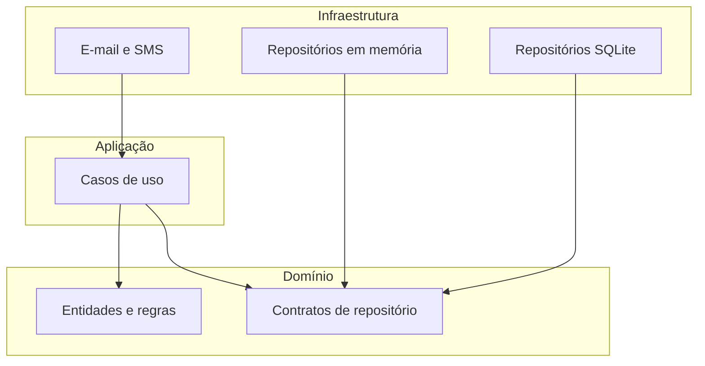

# Capítulo 18 — Casos de uso e camadas

!!! info "Situação da Empresa"

    A equipe cresceu. Duas pessoas novas entraram no projeto e abriram a pasta `ecommerce/` pela primeira vez. Depois de meia hora, uma delas perguntou:

    "Se eu precisar mudar a regra de cancelamento, em qual arquivo eu mexo? E se eu quiser trocar o SQLite por outro banco?"

    A resposta correta para as duas perguntas existe — mas só quem escreveu o código sabe. Não há nada na estrutura da pasta que diga qual arquivo é qual.

O sistema faz muita coisa agora. Mas olhe a lista de arquivos da pasta, do jeito que ela está:

```text
ecommerce/
├── pedido.py
├── produto.py
├── cliente.py
├── cupom.py
├── estrategia_desconto.py
├── criador_pagamento.py
├── expedidor.py
├── servico_pedido.py
├── servico_notificacao_pedido.py
├── notificacao.py
├── repositorio_pedido.py
├── repositorio_pedido_memoria.py
├── repositorio_pedido_sqlite.py
├── esquema_sqlite.py
└── ... (mais uns vinte arquivos)
```

`pedido.py` (a regra de negócio mais central do sistema) mora ao lado de `esquema_sqlite.py` (um detalhe de armazenamento). Quem lê não distingue o que é essencial do que é circunstancial. Pior: nada impede que, amanhã, alguém escreva `import sqlite3` dentro de `pedido.py`.

---

## 🧠 Pense

Classifique cada arquivo acima em uma destas três perguntas:

1. Descreve **o que o negócio é**? (regras, entidades, vocabulário)
2. Descreve **o que o sistema faz** em resposta a um pedido de alguém? (orquestração)
3. Descreve **como falamos com o mundo externo**? (banco de dados, envio de mensagens)

Você vai notar que `ServicoPedido` não se encaixa bem em nenhuma: ele orquestra, mas também sabe de repositório, de notificação, de expedição… Guarde essa dúvida.

---

## Três camadas

A resposta que a engenharia de software encontrou, depois de muito tropeço, é separar o sistema em **camadas**, cada uma com um papel:

!!! important "💡 Conceito — Camadas"

    | Camada | Papel | No nosso projeto |
    |---|---|---|
    | **Domínio** | O que o negócio é: entidades, regras, vocabulário | `Pedido`, `Produto`, `Cupom`, estratégias, `Pagamento`, `Expedidor`, os **contratos** dos repositórios |
    | **Aplicação** | O que o sistema faz: coordena o domínio para atender uma intenção de alguém | Os casos de uso, o serviço de notificação |
    | **Infraestrutura** | Como falamos com o mundo externo: banco, envio de mensagem, arquivos | Repositórios em memória e em SQLite, notificações por e-mail e SMS |

    O valor das camadas não está nas pastas — está na **regra de quem pode conhecer quem**.



A regra é uma só: **as dependências apontam para dentro**. O domínio não conhece ninguém. A aplicação conhece o domínio. A infraestrutura conhece a aplicação e o domínio. Nunca no sentido contrário. Repare que os repositórios SQLite apontam **para o contrato** (`CONT`), que mora no domínio: o domínio define o que precisa, e a infraestrutura se adapta.

Essa regra, e por que ela funciona, é o assunto do próximo capítulo. Por ora, vamos organizar a casa.

---

## Reorganizando os arquivos

Cada arquivo vai para a sua camada:

```text
ecommerce/
├── dominio/
│   ├── pedido.py, produto.py, cliente.py, carrinho.py, cupom.py ...
│   ├── estrategia_desconto.py, estrategia_frete.py
│   ├── pagamento.py, criador_pagamento.py
│   ├── entrega.py, expedidor.py
│   ├── repositorio_pedido.py       ← contrato
│   └── repositorio_produto.py      ← contrato
├── aplicacao/
│   ├── cadastrar_produto.py
│   ├── finalizar_compra.py
│   ├── pagar_pedido.py
│   ├── despachar_pedido.py
│   └── servico_notificacao_pedido.py
├── infraestrutura/
│   ├── repositorio_pedido_memoria.py
│   ├── repositorio_pedido_sqlite.py
│   ├── repositorio_produto_memoria.py
│   ├── repositorio_produto_sqlite.py
│   ├── esquema_sqlite.py
│   ├── notificacao.py
│   └── criador_notificacao.py
└── composicao.py
```

Três decisões de classificação merecem explicação, porque não são óbvias:

- **Os contratos dos repositórios ficam no domínio**, e as implementações na infraestrutura. É o domínio que diz "preciso de algo que guarde pedidos"; como isso é feito não lhe interessa.
- **`CriadorPagamento` e `Expedidor` ficam no domínio.** Eles criam objetos do negócio (`Pagamento`, `Entrega`) e não falam com nenhum sistema externo.
- **`NotificacaoEmail` e `NotificacaoSMS` ficam na infraestrutura.** Enviar e-mail é falar com o mundo externo. Vamos precisar voltar a este ponto.

Os testes seguem as mesmas pastas (`tests/dominio`, `tests/aplicacao`, `tests/infraestrutura`). Na prática, mover os arquivos é mecânico — o trabalho de verdade é decidir **qual é qual**.

!!! warning "⚠️ Erro comum — camadas só de pasta"

    Criar as três pastas e mover arquivos para dentro delas **não** cria camadas. Se `dominio/pedido.py` ainda tiver `import sqlite3`, a estrutura é só decoração: o domínio continua preso ao banco. A separação é uma regra de dependência, e uma regra só vale se for verificada — em breve vamos escrever um teste para isso.

---

## O `ServicoPedido` se divide

Lembra da dúvida do exercício de reflexão? O `ServicoPedido` do capítulo anterior tinha três operações — finalizar a compra, pagar, despachar — e recebia quatro colaboradores no construtor. Quem chama `pagar` carrega, de brinde, a dependência do expedidor, que nada tem a ver com pagamento.

Cada operação responde a uma **intenção diferente de alguém**: "quero comprar", "quero pagar", "quero enviar". Em vez de um serviço genérico, cada intenção vira uma classe pequena: um **caso de uso**.

!!! important "💡 Conceito — Caso de uso"

    Um **caso de uso** é uma classe da camada de aplicação que representa **uma coisa que alguém quer fazer** com o sistema. Ele não contém regra de negócio — essas continuam nas entidades. Ele **coordena**: busca os objetos nos repositórios, pede a eles que executem a regra, guarda o resultado e dispara o que mais for preciso.

    Convenção do curso: um método público, `executar`, e um nome no imperativo — `PagarPedido`, `DespacharPedido`.

```python title="ecommerce/aplicacao/pagar_pedido.py" linenums="1"
class PagarPedido:
    """Caso de uso: confirmar o pagamento de um pedido e avisar o cliente."""

    def __init__(
        self,
        repositorio_pedido: RepositorioPedido,
        criador_pagamento: CriadorPagamento,
        servico_notificacao: ServicoNotificacaoPedido,
    ) -> None:
        self._repositorio_pedido = repositorio_pedido
        self._criador_pagamento = criador_pagamento
        self._servico_notificacao = servico_notificacao

    def executar(
        self,
        pedido_id: int,
        cliente: Cliente,
        forma: FormaPagamento = FormaPagamento.PIX,
        **dados: object,
    ) -> None:
        pedido = self._repositorio_pedido.obter(pedido_id)
        pedido.confirmar_pagamento(self._criador_pagamento, forma, **dados)
        self._repositorio_pedido.atualizar(pedido)
        self._servico_notificacao.pedido_pago(pedido, cliente)
```

O corpo é o mesmo ciclo que já conhecíamos — obter, agir, atualizar, notificar. O que mudou é **quem carrega o quê**: `PagarPedido` recebe só o que precisa para pagar. Sem expedidor.

Os outros três seguem o mesmo molde:

| Caso de uso | Colaboradores | O que coordena |
|---|---|---|
| `CadastrarProduto` | `RepositorioProduto` | Cria o `Produto` com sua `Categoria` e o guarda |
| `FinalizarCompra` | `RepositorioPedido` | Transforma o carrinho do cliente em pedido e o guarda |
| `PagarPedido` | `RepositorioPedido`, `CriadorPagamento`, `ServicoNotificacaoPedido` | Confirma o pagamento e avisa o cliente |
| `DespacharPedido` | `RepositorioPedido`, `Expedidor`, `ServicoNotificacaoPedido` | Envia o pedido e avisa o cliente |

!!! info "🏗️ Decisão de Projeto — um serviço ou vários casos de uso?"

    | Alternativa | Vantagem | Desvantagem |
    |---|---|---|
    | Um `ServicoPedido` com vários métodos | Menos arquivos | Cresce sem limite; cada método arrasta dependências que não usa; difícil de testar isoladamente |
    | Um caso de uso por intenção | Cada classe tem poucas dependências e uma razão para mudar (**SRP**) | Mais arquivos; as classes são pequenas e parecidas |

    Escolhemos a segunda. A repetição de estrutura entre os casos de uso é um custo pequeno, que se paga a cada vez que um deles precisa mudar sozinho.

!!! info "📖 Nomenclatura — isto é um Command?"

    Não exatamente. O padrão **Command** transforma uma requisição em um **objeto que carrega os dados** ("pagar o pedido 12 com Pix"). Nossos casos de uso não carregam dados: os colaboradores entram pelo construtor e os parâmetros, em `executar`. Por isso o nome mais adequado para eles é *Application Service* (ou *Interactor*): um parente simplificado do Command.

    A forma fiel separaria o **comando** (só os dados, `PagarPedidoComando`) do **handler** (quem executa), como em arquiteturas CQRS. Vale guardar a ideia: um comando expressa uma *intenção* ("quero pagar"), e no Módulo 6 vamos contrastá-la com um *evento*, que registra um *fato ocorrido* ("o pedido foi pago").

---

## A raiz de composição ganha um arquivo

Os colaboradores continuam chegando por injeção. Mas agora há mais peças, e elas pertencem a camadas diferentes. Quem junta tudo precisa ter acesso às três — e é justamente por isso que a raiz de composição **não pertence a nenhuma camada**: ela fica fora delas, em `composicao.py`.

```python title="ecommerce/composicao.py" linenums="1"
def montar_aplicacao(caminho_banco: str = ":memory:") -> Aplicacao:
    """Raiz de composicao: o unico lugar que conhece as tres camadas."""
    conexao = sqlite3.connect(caminho_banco)
    criar_esquema(conexao)
    repositorio_produto = RepositorioProdutoSQLite(conexao)
    repositorio_pedido = RepositorioPedidoSQLite(conexao, repositorio_produto)
    servico_notificacao = ServicoNotificacaoPedido(CriadorNotificacao())

    return Aplicacao(
        cadastrar_produto=CadastrarProduto(repositorio_produto),
        finalizar_compra=FinalizarCompra(repositorio_pedido),
        pagar_pedido=PagarPedido(repositorio_pedido, CriadorPagamento(), servico_notificacao),
        despachar_pedido=DespacharPedido(
            repositorio_pedido, ExpedidorLojaCentral(), servico_notificacao
        ),
    )
```

`Aplicacao` é só um pacote que agrupa os quatro casos de uso prontos. Quem usa o sistema (uma tela, um script, um teste) chama:

```python
app = montar_aplicacao()
notebook = app.cadastrar_produto.executar("Notebook", 3500.0, 10, "Informática")

pedido = app.finalizar_compra.executar(maria)
app.pagar_pedido.executar(pedido.id, maria)
app.despachar_pedido.executar(pedido.id, maria)
```

Quem chama não importa uma única classe de infraestrutura. É a diferença entre usar o sistema e **montar** o sistema.

---

## Como saber se as camadas estão respeitadas?

Vamos escrever o teste prometido. Ele percorre os arquivos de cada camada e confere quais outras camadas eles importam:

```python title="tests/test_arquitetura.py" linenums="1"
def _camadas_importadas(camada: str) -> set[str]:
    """Camadas do ecommerce que os arquivos de `camada` importam."""
    importadas: set[str] = set()
    for arquivo in (RAIZ / camada).rglob("*.py"):
        for no in ast.walk(ast.parse(arquivo.read_text())):
            if isinstance(no, ast.ImportFrom) and no.module:
                partes = no.module.split(".")
                if partes[0] == "ecommerce" and len(partes) > 1:
                    importadas.add(partes[1])
    return importadas


def test_dominio_nao_conhece_as_outras_camadas() -> None:
    assert not _camadas_importadas("dominio") & {"aplicacao", "infraestrutura"}


def test_aplicacao_nao_conhece_a_infraestrutura() -> None:
    assert "infraestrutura" not in _camadas_importadas("aplicacao")
```

Rode. O primeiro teste passa: o domínio está limpo. O segundo **falha**: o conjunto de camadas importadas pela aplicação contém `"infraestrutura"`. Alguém na camada de aplicação está importando algo da infraestrutura. Quem?

??? question "Descubra antes de abrir o código"

    Procure em `aplicacao/` por `import ... infraestrutura`. Olhe o `ServicoNotificacaoPedido`: ele recebe um `CriadorNotificacao` — e essa classe mora em `infraestrutura/`, porque é ela que sabe criar `NotificacaoEmail` e `NotificacaoSMS`. A aplicação importa a classe concreta só para declarar o tipo do parâmetro.

Esse é um acoplamento escondido, do mesmo tipo dos que corrigimos no Módulo 4, mas agora entre camadas. Este capítulo termina sem corrigi-lo, **de propósito**. Em vez de esconder a violação, deixamos o teste registrá-la como falha conhecida:

```python title="tests/test_arquitetura.py" linenums="1" hl_lines="1-4"
@pytest.mark.xfail(
    strict=True,
    reason="divida visivel: ServicoNotificacaoPedido ainda importa a factory concreta",
)
def test_aplicacao_nao_conhece_a_infraestrutura() -> None:
    assert "infraestrutura" not in _camadas_importadas("aplicacao")
```

`xfail` significa "falha esperada". Com `strict=True`, se alguém consertar o problema sem tirar a marcação, o teste **reclama** por ter passado inesperadamente — a dívida não pode ser esquecida nem resolvida em silêncio.

```bash
$ pytest tests/
```

??? tip "160 testes passando, 1 falha esperada"

    Os testes antigos do `ServicoPedido` foram substituídos por testes de cada caso de uso (rodando contra memória **e** SQLite, pela fixture `infra`), mais um teste que monta a aplicação inteira pela raiz de composição, e os dois testes de arquitetura — um passando, um marcado como falha esperada.

---

## 🧩 Aplicando ao Projeto Financeiro

Organize o seu Projeto Financeiro nas três camadas.

1. Classifique cada arquivo seguindo as três perguntas do exercício de reflexão. Alguma classe ficou difícil de classificar? Anote qual e por quê.
2. Quebre o seu serviço de importação em casos de uso. Sugestões de intenções do usuário: `ImportarExtrato`, `GerarRelatorioMensal`, `RegistrarLancamento`. Cada um deve ter só os colaboradores que realmente usa.
3. Crie um `composicao.py` e escreva o teste de arquitetura com as duas regras. Se algum deles falhar, decida: corrigir agora ou registrar como dívida com `xfail(strict=True)`, como fizemos aqui.

Documente: quantas violações o teste encontrou na primeira rodada?

---

## 🎯 Exercícios

**Nível 1.** Adicione o caso de uso `ListarProdutos`, que devolve todos os produtos do catálogo. Qual colaborador ele precisa? Escreva o teste rodando contra as duas implementações do repositório.

**Nível 2.** Crie `CancelarPedido`. A regra de quais estados permitem cancelar já existe no `Pedido`. O que o caso de uso precisa fazer além de chamá-la? Se amanhã surgir a regra "cancelar um pedido pago exige reembolso", ela mora no caso de uso ou no domínio? Justifique.

**🚀 Desafio.** O `Cliente` aparece como parâmetro em quase todos os casos de uso, mas ainda não é guardado por nenhum repositório. Isso é um problema de design? Defenda uma posição e esboce como seria `RepositorioCliente`.

---

## 📌 Resumo

- Uma pasta plana mistura regra de negócio, coordenação e detalhes técnicos
- **Camadas**: domínio (o que o negócio é), aplicação (o que o sistema faz), infraestrutura (como falamos com o mundo externo)
- A regra das camadas é de **dependência**: tudo aponta para dentro; o domínio não conhece ninguém
- Os **contratos** dos repositórios moram no domínio; as **implementações**, na infraestrutura
- O `ServicoPedido` se dividiu em **casos de uso**: uma classe por intenção, com só as dependências de que precisa
- Um caso de uso não contém regra de negócio — coordena objetos que a contêm
- A raiz de composição fica fora das camadas, porque precisa enxergar todas
- Um teste de arquitetura verifica a regra automaticamente; uma violação conhecida fica registrada como dívida visível

## O que mudou no sistema

- ✔ Código organizado em `dominio/`, `aplicacao/` e `infraestrutura/`
- ✔ `CadastrarProduto`, `FinalizarCompra`, `PagarPedido`, `DespacharPedido` substituem o `ServicoPedido`
- ✔ `composicao.py` monta o sistema inteiro num único lugar
- ✔ O domínio não importa nenhuma outra camada (verificado por teste)
- ❌ A aplicação ainda importa uma classe concreta da infraestrutura (falha esperada no teste)
- ❌ Escolher entre memória e SQLite exige editar a raiz de composição

## O que vem a seguir

Temos um teste que falha de propósito. Ele aponta para uma pergunta mais profunda do que parece: se a aplicação precisa **enviar uma notificação** mas quem sabe enviar mora na infraestrutura, e a regra diz que a aplicação não pode conhecer a infraestrutura… como ela envia? A resposta já apareceu no curso desde o Módulo 3, com um outro nome — e é o assunto do próximo capítulo: **Inversão de Dependências**.
