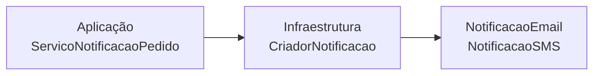
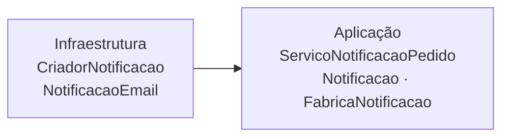
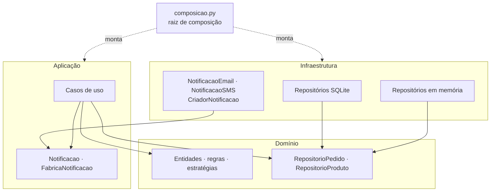

# Capítulo 19 — Quem depende de quem?

!!! info "Situação da Empresa"

    A pessoa que liderava a revisão técnica abriu a suíte de testes na reunião e apontou para uma linha amarela: **1 xfailed**.

    "Isso é uma falha que a gente sabe que existe e deixou marcada. Está certo deixar assim por um capítulo. Mas ela diz que a camada de aplicação importa a infraestrutura, e a gente acabou de criar camadas exatamente para isso não acontecer. Quero essa linha verde antes de a gente falar de qualquer funcionalidade nova."

Este é um capítulo curto em código e longo em ideias. O problema a resolver cabe numa linha de teste. Mas a ideia por trás dele é o que sustenta tudo o que construímos neste módulo.

---

## O problema, outra vez

Olhe o que `ServicoNotificacaoPedido` faz. Quando um pedido é pago, ele precisa **avisar o cliente**. Avisar significa criar uma notificação do canal certo (e-mail ou SMS) e enviá-la. Hoje o código é este:

```python title="ecommerce/aplicacao/servico_notificacao_pedido.py" linenums="1" hl_lines="1 6"
from ecommerce.infraestrutura.criador_notificacao import CriadorNotificacao


class ServicoNotificacaoPedido:

    def __init__(self, criador_notificacao: CriadorNotificacao) -> None:
        self._criador_notificacao = criador_notificacao
```

A aplicação precisa de "alguém que crie notificações" e importa, para dizer isso, a **classe concreta** — a que vive na infraestrutura e sabe de e-mail e SMS. O fluxo de dependência de código ficou assim:



A aplicação **depende** da infraestrutura. Se a infraestrutura mudar — se trocarmos o provedor de e-mail, ou deixarmos de usar SMS —, a aplicação pode precisar mudar junto. E a camada de aplicação, que deveria ser testável sozinha, passa a carregar o código de envio de mensagens.

---

## 🧠 Pense

Duas perguntas, antes de seguir:

1. A aplicação **precisa** saber que existem e-mail e SMS, ou só precisa saber que existe *algo capaz de enviar uma notificação*?
2. Se o contrato do que a aplicação precisa estivesse **dentro da própria aplicação**, a infraestrutura teria como cumpri-lo?

---

## O princípio

!!! important "💡 Conceito — Princípio da Inversão de Dependências (DIP)"

    O **D** do SOLID diz duas coisas:

    1. Módulos de alto nível (as regras) não devem depender de módulos de baixo nível (os detalhes). **Ambos devem depender de abstrações.**
    2. As abstrações não devem depender de detalhes; **os detalhes é que devem depender das abstrações**.

    A parte que mais passa despercebida: a abstração **pertence a quem a usa**, não a quem a implementa. É o alto nível que define o contrato do que precisa; o baixo nível se adapta a ele.

O nome "inversão" vem daqui. Sem o princípio, a seta de dependência vai de quem usa para quem implementa (aplicação → infraestrutura). Com ele, a abstração fica junto de quem usa, e a seta da implementação **inverte** e aponta de volta para ela (infraestrutura → aplicação).

Você já viu esse movimento sem o nome:

| Onde | Quem precisa | Contrato | Quem cumpre |
|---|---|---|---|
| Capítulo 9 | `Pedido` | `EstrategiaDesconto` | `DescontoPercentual`… |
| Capítulo 16 | casos de uso | `RepositorioPedido` (no **domínio**) | `RepositorioPedidoSQLite` (na infraestrutura) |
| Este capítulo | `ServicoNotificacaoPedido` | `Notificacao` e uma fábrica (na **aplicação**) | `NotificacaoEmail`, `CriadorNotificacao` (na infraestrutura) |

O repositório já estava invertido: o contrato mora no domínio e o SQLite se adapta a ele. A notificação ficou de fora porque o contrato (`Notificacao`) estava no mesmo arquivo das implementações, dentro da infraestrutura.

---

## A correção

A solução é mover o contrato para a camada de quem o usa. Criamos, em `aplicacao/`, um arquivo com duas coisas — o que a aplicação precisa:

```python title="ecommerce/aplicacao/notificacao.py" linenums="1"
class Notificacao(ABC):
    """Porta de saida: o que a aplicacao precisa para avisar o cliente."""

    @abstractmethod
    def enviar(self, destinatario: str, mensagem: str) -> None:
        ...


class FabricaNotificacao(Protocol):
    """O que a aplicacao exige de quem sabe criar a notificacao de um canal."""

    def criar(self, canal: CanalNotificacao) -> Notificacao:
        ...
```

`Notificacao` é a mesma abstração de antes, só que mudou de endereço. `FabricaNotificacao` é novo: descreve, sem implementar nada, o que o serviço espera receber. Quem escreveu `CriadorNotificacao` nem precisa saber que esse contrato existe, porque ele já tem um método `criar(canal)`.

!!! info "🏗️ Decisão de Projeto — `ABC` ou `Protocol`?"

    Usamos os dois, por razões diferentes:

    - **`Notificacao` como `ABC`.** As implementações (`NotificacaoEmail`, `NotificacaoSMS`) *herdam* explicitamente. O vínculo é intencional e visível.
    - **`FabricaNotificacao` como `Protocol`.** É uma descrição de formato ("qualquer objeto com um método `criar(canal)`"). Quem cumpre não precisa herdar de nada nem importar nada da aplicação.

    Um `Protocol` é "tipagem estrutural": o que importa é ter o formato certo. Isso ajuda a manter o domínio e a infraestrutura desacoplados. A desvantagem é que o vínculo é menos explícito, então o usamos para contratos pequenos, de um método.

A infraestrutura agora aponta para a aplicação:

```python title="ecommerce/infraestrutura/notificacao.py" linenums="1"
from ecommerce.aplicacao.notificacao import Notificacao


class NotificacaoEmail(Notificacao):
    def enviar(self, destinatario: str, mensagem: str) -> None:
        print(f"[E-MAIL -> {destinatario}] {mensagem}")
```

E o serviço declara o que precisa, sem importar nada de fora de sua camada:

```python title="ecommerce/aplicacao/servico_notificacao_pedido.py" linenums="1" hl_lines="1 6"
from ecommerce.aplicacao.notificacao import FabricaNotificacao


class ServicoNotificacaoPedido:

    def __init__(self, criador_notificacao: FabricaNotificacao) -> None:
        self._criador_notificacao = criador_notificacao
```

O resto do arquivo não mudou. Só o **tipo** do parâmetro e a origem do import.

O fluxo de dependência agora é este:



A seta virou. A infraestrutura depende da aplicação; a aplicação não sabe que a infraestrutura existe. Se amanhã trocarmos o provedor de e-mail, só a infraestrutura muda.

Rode o teste de arquitetura, agora sem o `xfail`:

```python title="tests/test_arquitetura.py" linenums="1"
def test_aplicacao_nao_conhece_a_infraestrutura() -> None:
    assert "infraestrutura" not in _camadas_importadas("aplicacao")
```

Verde. Se o `xfail(strict=True)` tivesse ficado ali, o teste reclamaria de ter passado: é a dívida cobrando para ser fechada.

!!! warning "⚠️ Erro comum — o contrato do lado errado"

    O erro mais frequente ao tentar aplicar o DIP é criar a interface, mas deixá-la **no mesmo lugar da implementação**. Se `Notificacao` continuasse em `infraestrutura/notificacao.py`, a aplicação teria que importar o arquivo da infraestrutura para declarar o tipo — a mesma dependência, só que com mais uma classe no meio. A abstração precisa estar do lado de **quem a usa**.

    O erro oposto também existe: criar uma interface para tudo. Só vale inverter uma dependência quando o detalhe é algo que muda, é externo ao negócio ou precisa ser substituído nos testes. Uma classe como `ItemPedido` não precisa de interface.

---

## Três coisas que parecem a mesma coisa

Neste módulo você ouviu três termos que se misturam com facilidade. Cada um responde a uma pergunta diferente:

| Conceito | Pergunta que responde | Exemplo no projeto |
|---|---|---|
| **Inversão de Dependências** (DIP) | *Quem define a abstração? Para onde apontam as setas de dependência do código-fonte?* | `Notificacao` mora na aplicação; a infraestrutura depende dela |
| **Injeção de Dependências** (DI) | *Como o objeto recebe o que precisa?* | `ServicoNotificacaoPedido(criador_notificacao)` recebe pelo construtor |
| **Raiz de composição** | *Onde as peças são escolhidas e ligadas?* | `composicao.py` |

O DIP é um **princípio de design** (a direção das dependências). A DI é uma **técnica** que o torna prático (quem usa recebe de fora). A raiz de composição é o **lugar** onde a técnica é aplicada. Um sistema pode usar DI sem respeitar DIP — injetar uma classe concreta pelo construtor, por exemplo — mas o inverso é difícil: sem alguém entregando as implementações, não há como a abstração fazer seu trabalho.

---

## A recompensa: trocar peças só na composição

Com as camadas e as dependências no lugar certo, escolher onde os dados ficam deixa de ser assunto do sistema e vira assunto de quem monta o sistema. A raiz de composição ganha um parâmetro:

```python title="ecommerce/composicao.py" linenums="1" hl_lines="1 7-14"
def montar_aplicacao(armazenamento: str = "sqlite", caminho_banco: str = ":memory:") -> Aplicacao:
    """Raiz de composicao: o unico lugar que conhece as tres camadas.

    Escolher onde os dados ficam e uma decisao de montagem, nao de dominio.
    """
    if armazenamento == "memoria":
        repositorio_produto = RepositorioProdutoMemoria()
        repositorio_pedido = RepositorioPedidoMemoria()
    elif armazenamento == "sqlite":
        conexao = sqlite3.connect(caminho_banco)
        criar_esquema(conexao)
        repositorio_produto = RepositorioProdutoSQLite(conexao)
        repositorio_pedido = RepositorioPedidoSQLite(conexao, repositorio_produto)
    else:
        raise ValueError(f"Armazenamento desconhecido: {armazenamento}")
    # ... restante igual ...
```

E um único teste mostra que o **mesmo fluxo** de compra funciona nas duas configurações, sem tocar em caso de uso nenhum:

```python title="tests/test_composicao.py" linenums="1"
@pytest.mark.parametrize("armazenamento", ["memoria", "sqlite"])
def test_aplicacao_montada_executa_o_fluxo_completo(armazenamento: str) -> None:
    app = montar_aplicacao(armazenamento)
    # ... cadastrar produto, finalizar compra, pagar, despachar ...
    assert entrega.pedido.status == "enviado"
```

Esse `if/elif` na raiz de composição não é um retrocesso ao `if/elif` de criação que combatemos no Módulo 4. Lá, ele espalhado pelo domínio acoplava cada ponto de uso às classes concretas. Aqui, ele existe num lugar só, e é a **função** desse lugar saber de todas as classes concretas.

---

## 🔍 O ORM, de novo

No capítulo anterior, a tabela de "o que mudaria com um ORM" tinha uma coluna que agora fica clara. Em termos de camadas:

- **`dominio/`** — não muda. Não importa o ORM.
- **`aplicacao/`** — não muda. Fala só com os contratos de repositório.
- **`infraestrutura/`** — ganha `repositorio_pedido_orm.py` e `repositorio_produto_orm.py`, que usam a sessão do ORM, e perde (ou mantém, se ainda quiser a versão SQL) os arquivos SQLite.
- **`composicao.py`** — ganha um `elif armazenamento == "orm":` que cria a sessão e monta os dois repositórios novos.
- **`requirements.txt`** — ganha a biblioteca.
- **`tests/conftest.py`** — ganha `"orm"` na lista de parâmetros da fixture `infra`.

O teste de arquitetura vigia o limite. Hoje ele proíbe o domínio de importar as outras camadas; basta estendê-lo para proibir também a biblioteca do ORM (é o Nível 1 dos exercícios, com `sqlite3`). Assim, se alguém importar o ORM dentro do domínio "para poupar código", o teste reclama. A regra de dependência transforma a pergunta "será que dá para trocar o ORM depois?" numa propriedade que o teste confere.

---

## A arquitetura que construímos



Leia as setas contínuas: todas apontam para o domínio ou para a aplicação, nunca na direção oposta. As setas pontilhadas mostram que a raiz de composição é a única que enxerga tudo.

Um arquivo de teste vigia isso por inteiro:

```python title="tests/test_arquitetura.py" linenums="1"
def test_dominio_nao_conhece_as_outras_camadas() -> None: ...

def test_aplicacao_nao_conhece_a_infraestrutura() -> None: ...

def test_infraestrutura_so_depende_de_dominio_e_aplicacao() -> None: ...

def test_nao_ha_modulos_soltos_alem_da_raiz_de_composicao() -> None: ...
```

```bash
$ pytest tests/
```

??? tip "165 testes passando"

    Sem falhas esperadas. O `xfail` do capítulo anterior virou teste verde. Entraram dois testes de arquitetura novos (a infraestrutura só depende de domínio e aplicação; não há módulos soltos fora da raiz de composição), o teste da raiz de composição passou a rodar com memória **e** SQLite, e o caso de erro para armazenamento desconhecido.

---

## 🧩 Aplicando ao Projeto Financeiro

Feche a arquitetura do seu Projeto Financeiro.

1. Identifique no seu serviço de importação ou de relatório **qualquer** import que cruze camadas no sentido errado. Corrija movendo o contrato para a camada de quem usa.
2. Quais dependências do seu sistema financeiro são "detalhes que mudam"? Leitores de arquivo? Exportadores? O envio de alertas? Para cada uma, diga onde mora o contrato.
3. Faça sua raiz de composição aceitar pelo menos duas configurações (por exemplo, repositório em memória × SQLite), e escreva um teste parametrizado, como o deste capítulo.

Documente: dos três itens acima, qual deu mais trabalho? E o teste de arquitetura, encontrou algo que você não tinha percebido?

---

## 🎯 Exercícios

**Nível 1.** Escreva um teste de arquitetura que proíbe o domínio de importar `sqlite3`. Dica: o teste existente olha para `ecommerce.*`; adapte-o para olhar também módulos da biblioteca padrão.

**Nível 2.** `ServicoNotificacaoPedido` usa `FabricaNotificacao` como `Protocol`. Reescreva esse contrato como `ABC`, fazendo `CriadorNotificacao` herdar dele. O que mudou na infraestrutura? Que opção você prefere para esse caso, e por quê?

**🚀 Desafio.** Acrescente um canal novo, **push**, e meça o impacto: quais arquivos você teve que editar? Quais camadas foram tocadas? Compare com o que seria necessário se o contrato `Notificacao` ainda estivesse na infraestrutura e o serviço importasse as classes concretas.

---

## 📌 Resumo

- O teste de arquitetura apontou um acoplamento escondido: a aplicação importava uma classe concreta da infraestrutura
- **DIP**: o alto nível e o baixo nível dependem de abstrações, e **a abstração pertence a quem a usa**
- A correção foi mover o contrato (`Notificacao`) e descrever o que a aplicação exige (`FabricaNotificacao`) para dentro da aplicação; a infraestrutura passou a depender dela
- **DIP** é o princípio (direção das dependências), **DI** é a técnica (receber de fora), **raiz de composição** é o lugar (onde se escolhe e liga)
- Com as camadas e os contratos nos lugares certos, trocar memória por SQLite — ou por um ORM — é mudança na infraestrutura e na composição
- `Protocol` descreve formato; `ABC` cria um vínculo explícito — ambos servem como contrato, para necessidades diferentes
- Inverter tudo é tão ruim quanto não inverter nada: só vale para detalhes que mudam ou precisam ser substituídos

## O que mudou no sistema

- ✔ Domínio, aplicação e infraestrutura separados, com regra de dependência verificada por testes
- ✔ `Notificacao` e `FabricaNotificacao` fazem parte da aplicação; e-mail e SMS dependem delas
- ✔ A raiz de composição escolhe entre memória e SQLite sem tocar em nenhum caso de uso
- ✔ A suíte de contrato garante que cada implementação é substituível
- ❌ Pagamento, entrega, cupom e cliente ainda não são persistidos
- ❌ Cada caso de uso chama a notificação explicitamente — e vai chamar também o que mais surgir

## O que vem a seguir

Olhe `PagarPedido`. Ele paga o pedido, atualiza o repositório e avisa o cliente. Agora imagine as próximas demandas da empresa: dar baixa no estoque quando o pedido é pago, registrar uma linha de auditoria, escrever num log, avisar o time financeiro. Cada uma é "uma coisa a mais que acontece depois de um pagamento". Se cada nova reação virar mais uma linha dentro de `PagarPedido`, o caso de uso passa a conhecer todo mundo que tem interesse no pagamento — e a lista cresce sem parar.

É o mesmo problema de acoplamento que enfrentamos neste módulo, agora entre *quem faz* e *quem reage*. O Módulo 6 trata dele, com **eventos**.

Antes disso, consolide o seu Projeto Financeiro: [entregue a quarta parte](entrega.md).
