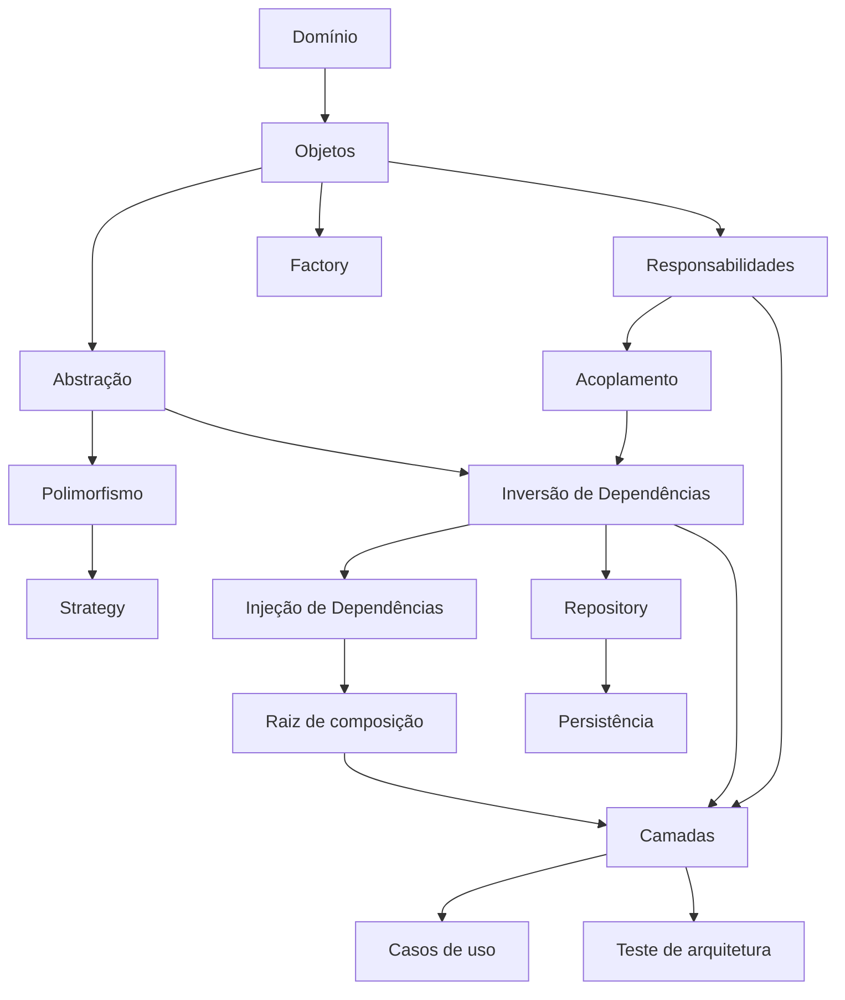

# Mapa de Conhecimento — Módulo 5

> **Do desenho dos objetos à organização do sistema**

Até o Módulo 4, a pergunta era como projetar objetos que colaboram bem. No Módulo 5 a pergunta sobe de nível: **como organizar o sistema inteiro** para que as regras de negócio não dependam de onde os dados ficam, nem de como o mundo externo é acessado.

## O que foi acrescentado

### Persistência e identidade

- **Identidade** — o que distingue uma entidade de outra com os mesmos valores. Um objeto que sobrevive ao programa precisa de um identificador estável (`id`), atribuído uma única vez por quem o guarda.
- **Persistência** — fazer o estado de um objeto sobreviver ao programa. É uma responsabilidade da infraestrutura, não do domínio.
- **Mapeamento objeto↔tabela** — a tradução entre o que o domínio fala (objetos) e o que o banco fala (tabelas e colunas). Pode ser feito à mão, como no curso, ou por um **ORM**.
- **Reconstituição** — recriar um objeto no estado em que ele estava, sem passar pelas regras de criação. É diferente de criar.

### Repository

- **Repository** — um objeto que se comporta como uma coleção de entidades de domínio e esconde onde elas são guardadas.

    ```
    Caso de uso
        ↓ obter(12)
    RepositorioPedido  (contrato, no domínio)
        ↑
    RepositorioPedidoSQLite / RepositorioPedidoMemoria  (infraestrutura)
    ```

- **Contrato de repositório** — fala a linguagem do domínio (`obter`, `adicionar`, `listar`, `atualizar`) e devolve objetos de domínio completos, nunca linhas ou dicionários.
- **Suíte de contrato** — um mesmo conjunto de testes que roda contra todas as implementações. Uma implementação só é aceita se passar nela; isso é o **Princípio de Liskov** conferido na prática.

### Arquitetura em camadas

- **Camadas** — separação do sistema em domínio (o que o negócio é), aplicação (o que o sistema faz) e infraestrutura (como falamos com o mundo externo).
- **Regra de dependência** — as dependências apontam para dentro: o domínio não conhece ninguém; a aplicação conhece o domínio; a infraestrutura conhece ambos.
- **Caso de uso** — uma classe da camada de aplicação que representa uma intenção de quem usa o sistema. Coordena objetos, mas não contém regra de negócio.
- **Raiz de composição** — fora das camadas, porque precisa enxergar todas. É onde se escolhe e liga cada implementação.
- **Teste de arquitetura** — um teste automatizado que verifica a regra de dependência, para que ela não seja apenas uma convenção.

### SOLID

O módulo fecha o **Dependency Inversion Principle (DIP)**, que o Módulo 4 apenas tocou:

> Módulos de alto nível não devem depender de módulos de baixo nível. Ambos devem depender de abstrações. **A abstração pertence a quem a usa.**

Também reforça o **SRP** (casos de uso pequenos, uma razão para mudar cada) e o **LSP** (implementações que passam na mesma suíte de contrato são substituíveis).

### Três conceitos que parecem um só

| Conceito | Pergunta que responde |
|---|---|
| **Inversão de Dependências** | Quem define a abstração? Para onde apontam as dependências? |
| **Injeção de Dependências** | Como o objeto recebe o que precisa? |
| **Raiz de composição** | Onde as peças são escolhidas e ligadas? |

## O mapa acumulado



## A pergunta central do módulo

> **Quem pode conhecer quem?**

A resposta final do módulo é:

```text
O domínio não conhece ninguém.

                 ↓

A abstração pertence a quem a usa.

                 ↓

Os detalhes (banco, e-mail, ORM) se adaptam às abstrações —
e são escolhidos num único ponto, a raiz de composição.
```

## Onde chegamos

```text
Módulo 1
Modelar conceitos e responsabilidades
        ↓
Módulo 2
Proteger estado e coordenar comportamentos
        ↓
Módulo 3
Isolar variações de comportamento
        ↓
Módulo 4
Isolar criação e montagem de dependências
        ↓
Módulo 5
Isolar o domínio dos detalhes técnicos
```

O sistema agora tem uma estrutura que diz o que é cada coisa e uma regra, verificada por testes, sobre quem pode depender de quem. O próximo passo é lidar com um tipo diferente de acoplamento: o de quem *causa* um acontecimento com quem *reage* a ele.
