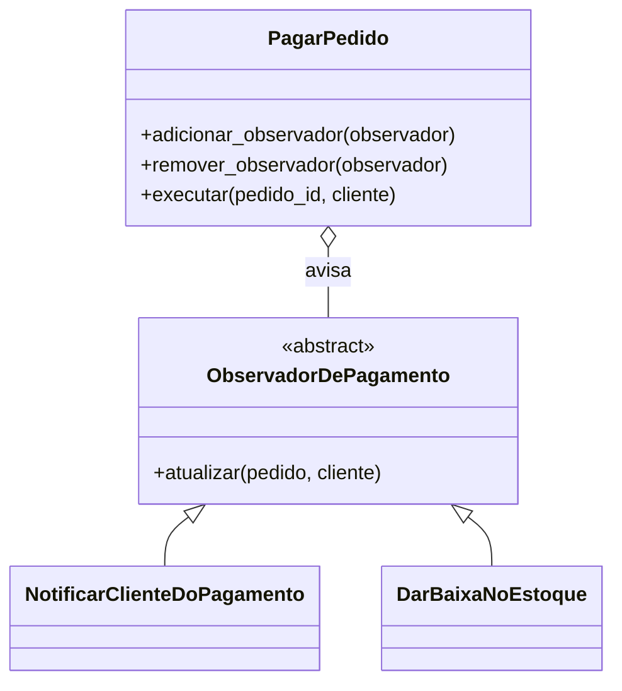

# Capítulo 20 — Quem precisa saber? (Observer)

!!! info "Situação da Empresa"

    O depósito ligou para o gerente. Um cliente comprou o último notebook, o pagamento foi confirmado, e dois dias depois uma segunda pessoa comprou o mesmo notebook. O site ainda mostrava uma unidade em estoque.

    "Cadê a baixa?", perguntou o gerente. "Quando o pedido é pago, o estoque tem que diminuir. Hoje alguém faz isso na mão, e esquece."

O pedido de ontem era simples de dizer: **quando um pagamento for confirmado, tire do estoque o que foi vendido**. Antes de escrever qualquer linha, vale olhar onde essa linha iria morar.

---

## O problema, concretamente

O caso de uso `PagarPedido`, no fim do Capítulo 19, faz isto:

```python title="ecommerce/aplicacao/pagar_pedido.py" linenums="1"
    def executar(self, pedido_id, cliente, forma=FormaPagamento.PIX, **dados) -> None:
        pedido = self._repositorio_pedido.obter(pedido_id)
        pedido.confirmar_pagamento(self._criador_pagamento, forma, **dados)
        self._repositorio_pedido.atualizar(pedido)
        self._servico_notificacao.pedido_pago(pedido, cliente)
```

O caminho curto para a nova exigência é acrescentar mais uma linha, ou duas:

```python title="O caminho curto" linenums="1" hl_lines="5-8"
    def executar(self, pedido_id, cliente, forma=FormaPagamento.PIX, **dados) -> None:
        pedido = self._repositorio_pedido.obter(pedido_id)
        pedido.confirmar_pagamento(self._criador_pagamento, forma, **dados)
        self._repositorio_pedido.atualizar(pedido)
        for item in pedido.itens:
            produto = self._repositorio_produto.obter(item.produto.id)
            produto.dar_baixa(item.quantidade)
            self._repositorio_produto.atualizar(produto)
        self._servico_notificacao.pedido_pago(pedido, cliente)
```

Funciona. E amanhã o time pede uma linha de auditoria, depois um aviso para o financeiro, depois uma pontuação de fidelidade. Veja o que acontece com o construtor de `PagarPedido`:

| Momento | O que `PagarPedido` precisa conhecer |
|---|---|
| Capítulo 19 | repositório de pedidos, criador de pagamento, serviço de notificação |
| Com a baixa de estoque | **+ repositório de produtos** |
| Com a auditoria | **+ registro de auditoria** |
| Com o aviso ao financeiro | **+ mais um colaborador** |

O caso de uso foi criado para uma coisa: **pagar um pedido**. Cada reação nova o obriga a mudar, a receber mais um colaborador e a ser testado de novo, mesmo que a regra de pagamento continue exatamente igual. Ele passou a ter uma razão para mudar a cada nova ideia da empresa.

---

## 🧠 Pense

Duas perguntas, antes de seguir:

1. A baixa de estoque é parte de **pagar** um pedido, ou é algo que **acontece por causa** de um pagamento?
2. Se o `PagarPedido` não soubesse quem se importa com o pagamento, como essas outras partes ficariam sabendo?

---

## A ideia: quem faz não chama; quem se importa se inscreve

Hoje o fluxo é este: o caso de uso **chama**, um por um, todos os que precisam saber. A inversão é pequena e poderosa: quem se importa **se inscreve** previamente, e o caso de uso só **avisa** "aconteceu", sem saber quantos são nem quem são.

!!! important "💡 Conceito — Observer"

    O **Observer** (observador) é um padrão em que um objeto, o **sujeito**, mantém uma lista de interessados, os **observadores**, e avisa todos eles quando algo acontece com ele. O sujeito conhece apenas **o contrato** do observador, nunca as classes concretas.

    Duas operações definem o sujeito: **adicionar** e **remover** observadores. Uma define o observador: **atualizar**, o método chamado quando há novidade.



É a mesma ideia de separar o que muda do que fica, que você já aplicou várias vezes. Aqui o que muda é **quem reage a um pagamento**.

---

## O contrato do observador

O primeiro passo é dizer, em um arquivo da camada de aplicação, o que significa "querer ser avisado de um pagamento":

```python title="ecommerce/aplicacao/observador_de_pagamento.py" linenums="1"
class ObservadorDePagamento(ABC):
    """Quem quer ser avisado quando um pedido e pago."""

    @abstractmethod
    def atualizar(self, pedido: Pedido, cliente: Cliente) -> None:
        ...
```

Repare onde ele mora: na **aplicação**, do lado de quem usa. É a regra do Capítulo 19: a abstração pertence a quem a usa.

---

## O sujeito

O `PagarPedido` troca o serviço de notificação, que recebia pelo construtor, por uma lista de observadores:

```python title="ecommerce/aplicacao/pagar_pedido.py" linenums="1" hl_lines="14 16-20 31-33"
class PagarPedido:
    """Caso de uso: confirmar o pagamento de um pedido e avisar quem se inscreveu."""

    def __init__(
        self,
        repositorio_pedido: RepositorioPedido,
        criador_pagamento: CriadorPagamento,
    ) -> None:
        self._repositorio_pedido = repositorio_pedido
        self._criador_pagamento = criador_pagamento
        self._observadores: list[ObservadorDePagamento] = []

    def adicionar_observador(self, observador: ObservadorDePagamento) -> None:
        self._observadores.append(observador)

    def remover_observador(self, observador: ObservadorDePagamento) -> None:
        self._observadores.remove(observador)

    def executar(
        self,
        pedido_id: int,
        cliente: Cliente,
        forma: FormaPagamento = FormaPagamento.PIX,
        **dados: object,
    ) -> None:
        pedido = self._repositorio_pedido.obter(pedido_id)
        pedido.confirmar_pagamento(self._criador_pagamento, forma, **dados)
        self._repositorio_pedido.atualizar(pedido)
        self._avisar_observadores(pedido, cliente)

    def _avisar_observadores(self, pedido: Pedido, cliente: Cliente) -> None:
        for observador in self._observadores:
            observador.atualizar(pedido, cliente)
```

O construtor encolheu: dois colaboradores, os que **pagar** de fato exige. A ordem do `executar` também importa: os observadores só são avisados **depois** de o pedido ter sido guardado como pago. Quem reage a um fato precisa encontrá-lo já verdadeiro.

---

## Os observadores

A notificação que estava dentro do caso de uso vira um observador, sem mudar o que ela faz:

```python title="ecommerce/aplicacao/observadores/notificar_cliente_do_pagamento.py" linenums="1"
class NotificarClienteDoPagamento(ObservadorDePagamento):
    """Avisa o cliente, pelo canal que ele prefere, que o pagamento foi confirmado."""

    def __init__(self, servico_notificacao: ServicoNotificacaoPedido) -> None:
        self._servico_notificacao = servico_notificacao

    def atualizar(self, pedido: Pedido, cliente: Cliente) -> None:
        self._servico_notificacao.pedido_pago(pedido, cliente)
```

E a novidade do dia, a baixa de estoque, nasce como um observador novo. A regra de "não vender o que não existe" é do **produto**, então fica nele:

```python title="ecommerce/dominio/produto.py" linenums="1"
class EstoqueInsuficienteError(Exception):
    pass


class Produto:
    # ...
    def dar_baixa(self, quantidade: int) -> None:
        if quantidade <= 0:
            raise ValueError("Quantidade deve ser positiva")
        if quantidade > self.quantidade_estoque:
            raise EstoqueInsuficienteError(
                f"Estoque de {self.nome}: restam {self.quantidade_estoque}, solicitado {quantidade}"
            )
        self.quantidade_estoque -= quantidade
```

O observador só **coordena**: percorre os itens, busca o produto, pede a baixa e guarda.

```python title="ecommerce/aplicacao/observadores/dar_baixa_no_estoque.py" linenums="1"
class DarBaixaNoEstoque(ObservadorDePagamento):
    """Tira do estoque as unidades vendidas em um pedido pago."""

    def __init__(self, repositorio_produto: RepositorioProduto) -> None:
        self._repositorio_produto = repositorio_produto

    def atualizar(self, pedido: Pedido, cliente: Cliente) -> None:
        for item in pedido.itens:
            produto = self._repositorio_produto.obter(item.produto.id)
            produto.dar_baixa(item.quantidade)
            self._repositorio_produto.atualizar(produto)
```

!!! warning "⚠️ Erro comum — usar o produto que veio no item"

    Por que o observador busca o produto de novo em vez de usar `item.produto`? Com o repositório em memória, os dois seriam o mesmo objeto. Com o SQLite, o `Produto` de um item de pedido relido é uma **cópia**, montada no momento da leitura. Dar baixa nela não mudaria nada no que está guardado. E, se o pedido tivesse dois itens do mesmo produto, cada cópia partiria do estoque antigo e uma baixa apagaria a outra.

    Buscar no repositório a cada item e chamar `atualizar` funciona nas duas implementações. É o contrato do Capítulo 16 sendo cumprido.

---

## Quem liga as peças

Quem decide que **estas** reações vão a **este** caso de uso é a raiz de composição:

```python title="ecommerce/composicao.py" linenums="1" hl_lines="4-5"
    servico_notificacao = ServicoNotificacaoPedido(CriadorNotificacao())

    # Quem reage a um pagamento e decidido aqui, na montagem, e nao dentro do caso de uso.
    pagar_pedido = PagarPedido(repositorio_pedido, CriadorPagamento())
    pagar_pedido.adicionar_observador(NotificarClienteDoPagamento(servico_notificacao))
    pagar_pedido.adicionar_observador(DarBaixaNoEstoque(repositorio_produto))
```

Essas linhas fazem o trabalho de antes e dão ao sistema uma propriedade nova: **acrescentar uma reação não exige abrir o `PagarPedido`**. Para a auditoria, bastaria um observador e uma linha de `adicionar_observador`.

O teste de ponta a ponta confere o resultado nas duas configurações de armazenamento:

```python title="tests/test_composicao.py" linenums="1"
@pytest.mark.parametrize("armazenamento", ["memoria", "sqlite"])
def test_pagar_da_baixa_no_estoque(armazenamento: str) -> None:
    app = montar_aplicacao(armazenamento)
    notebook = app.cadastrar_produto.executar("Notebook", 3500.0, 10, "Informática")
    # ... cliente com 2 notebooks no carrinho ...
    pedido = app.finalizar_compra.executar(maria)
    assert app.produtos.obter(notebook.id).quantidade_estoque == 10
    app.pagar_pedido.executar(pedido.id, maria)

    assert app.produtos.obter(notebook.id).quantidade_estoque == 8
```

```bash
$ pytest tests/
```

??? tip "191 testes passando"

    Os 165 do capítulo anterior continuam verdes, com os testes de `PagarPedido` ajustados ao novo construtor. Entraram: três testes de `Produto.dar_baixa`, um de persistência do estoque (nas duas implementações), cinco testes do sujeito (avisa na ordem, remove, funciona sem observadores, propaga falha), três do observador de estoque e um do de notificação, e o teste de ponta a ponta acima.

---

## O que o Observer não resolve

Antes de comemorar, rode mentalmente o cenário que o gerente descreveu: duas pessoas compram a **última** unidade. A segunda paga, e a baixa não pode ser feita. O que acontece? Este teste, que já existe no capítulo, mostra:

```python title="tests/aplicacao/test_pagar_pedido_observadores.py" linenums="1"
def test_observador_que_falha_impede_os_seguintes(self, cenario, infra, ordem) -> None:
    # Divida visivel: o Observer simples nao isola uma reacao da outra.
    caso, pedido, maria = cenario
    depois = ObservadorEspia("depois", ordem)
    caso.adicionar_observador(ObservadorQueFalha())
    caso.adicionar_observador(depois)
    with pytest.raises(RuntimeError):
        caso.executar(pedido.id, maria)
    assert depois.recebidos == []
    assert infra.pedidos.obter(pedido.id).status == "pago"
```

Três coisas aparecem ao mesmo tempo:

- o **erro sobe** para quem chamou `executar`, como se o pagamento tivesse falhado;
- os observadores **seguintes não rodam**: a falha de um derruba os outros;
- o pedido **está pago**, mesmo assim. O pagamento foi confirmado e guardado antes de os observadores serem avisados.

Deixamos isso registrado em teste porque é uma dívida conhecida. O Capítulo 22 volta a ela.

!!! warning "⚠️ Erro comum — depender da ordem dos observadores"

    No `montar_aplicacao`, a notificação foi inscrita **antes** da baixa de estoque. Se a baixa falhar, o cliente já foi avisado de que está tudo certo. E, se alguém trocar a ordem das duas linhas de inscrição, o comportamento do sistema muda sem que nenhum teste de domínio perceba.

    Um bom observador **não deve depender de ter rodado depois (ou antes) de outro**. Quando existir dependência de ordem, ela não é uma reação independente: é um passo do fluxo, e o lugar dela é o caso de uso.

!!! tip "💡 Dica — em Python, uma função também serve"

    Em linguagens como Java, o observador precisa ser um objeto com um método, porque não há como passar um "pedaço de código" adiante. Em Python, uma função (ou qualquer objeto com `__call__`) já é um *callback*, e o sujeito poderia guardar uma lista de funções. Usamos uma classe abstrata aqui para deixar visível o papel de cada parte. No próximo capítulo, os manipuladores serão chamáveis.

---

## Os limites desta forma do Observer

O Observer clássico resolveu o acoplamento do caso de uso. Mas olhe para o que foi construído e imagine o resto do sistema crescendo:

1. **Cada sujeito cuida da própria lista.** `DespacharPedido` também precisará de `adicionar_observador`, `remover_observador` e um laço de aviso: o mesmo código repetido em cada caso de uso.
2. **O observador é preso ao sujeito.** `ObservadorDePagamento` só serve para pagamento. Uma auditoria que queira registrar *tudo* o que acontece com um pedido teria de implementar um observador para cada sujeito e se inscrever em cada um.
3. **A raiz de composição precisa ter em mãos cada sujeito**, e inscrever cada observador no sujeito certo.
4. **O aviso não tem nome.** O método `atualizar(pedido, cliente)` diz "algo aconteceu", mas não diz **o quê**. O observador precisa deduzir, pelo sujeito a que está ligado, que aquilo foi um pagamento.

O último ponto é o mais importante. Aquilo que o sistema *anuncia* merece existir como um objeto, com nome, no passado: **o pedido foi pago**. É o assunto do próximo capítulo.

---

## 🧩 Aplicando ao Projeto Financeiro

Seu sistema também tem acontecimentos que interessam a mais de uma parte.

1. Escolha um caso de uso, por exemplo `RegistrarLancamento`. Liste tudo o que **deveria acontecer depois** que um lançamento é registrado: atualizar o saldo da categoria, verificar se uma meta foi estourada, avisar o usuário. Quantos desses itens são parte de "registrar"? Quantos são reações?
2. Implemente um `ObservadorDeLancamento` e o sujeito correspondente. Faça o alerta de **meta estourada** ser um observador, sem que `RegistrarLancamento` conheça a meta.
3. Escreva o teste em que o observador falha. O lançamento deve ficar registrado? O que o seu sistema faz hoje?

Documente: o que você teve de passar ao observador (`atualizar(...)`) para ele conseguir trabalhar? Estava tudo à mão?

---

## 🎯 Exercícios

**Nível 1.** Escreva o observador `RegistrarAuditoria`, que guarda numa lista uma linha como `"pedido 3 pago por Maria"`, e inscreva-o em `PagarPedido` na raiz de composição. Quantos arquivos de `aplicacao/` você precisou editar além do novo?

**Nível 2.** O `DarBaixaNoEstoque` pode falhar no meio, depois de ter dado baixa no primeiro item e antes do segundo. O que fica guardado? Escreva um teste que mostre o problema e discuta uma forma de evitá-lo.

**🚀 Desafio.** Faça o mesmo para `DespacharPedido`: crie um `ObservadorDeDespacho` e avise o cliente por ele. Compare o código novo com o de `PagarPedido`. O que se repete? Esse é o desconforto que o próximo capítulo resolve.

---

## 📌 Resumo

- Cada reação nova a um pagamento obrigava o `PagarPedido` a mudar, a receber mais um colaborador e a ser testado de novo
- O **Observer** inverte o fluxo: o sujeito mantém uma lista de observadores e os avisa, sem conhecer as classes concretas
- O contrato do observador mora na **aplicação**, do lado de quem o usa; a raiz de composição decide quem se inscreve
- O sujeito só avisa **depois** de guardar o estado: quem reage encontra o fato já verdadeiro
- `Produto.dar_baixa` guarda a regra do estoque no domínio; o observador só coordena, buscando o produto no repositório
- O Observer simples tem limites: lista repetida em cada sujeito, observador preso a um sujeito, aviso sem nome e **falha de um observador que derruba os outros**
- Um bom observador não depende da ordem em que os outros rodam

## O que mudou no sistema

- ✔ `PagarPedido` só paga, guarda e avisa; a notificação e a baixa de estoque são observadores
- ✔ Estoque reduzido quando o pedido é pago, nas duas configurações de armazenamento
- ✔ Acrescentar uma reação a um pagamento não exige abrir o caso de uso
- ❌ `DespacharPedido` ainda chama a notificação diretamente
- ❌ O erro de um observador derruba os seguintes, e quem pagou vê um erro mesmo com o pedido pago
- ❌ O aviso ("algo aconteceu") não diz o quê, e cada sujeito repete o mesmo código

## O que vem a seguir

O Observer deu nome a quem **reage**. Falta dar nome ao que **aconteceu**. No próximo capítulo, "o pedido foi pago" deixa de ser uma chamada de método e vira um objeto, um **fato**, que circula por um intermediário: o **barramento de eventos**. Com ele, a lista de observadores sai de dentro de cada caso de uso, e os dois problemas de repetição que acabamos de listar desaparecem juntos.
