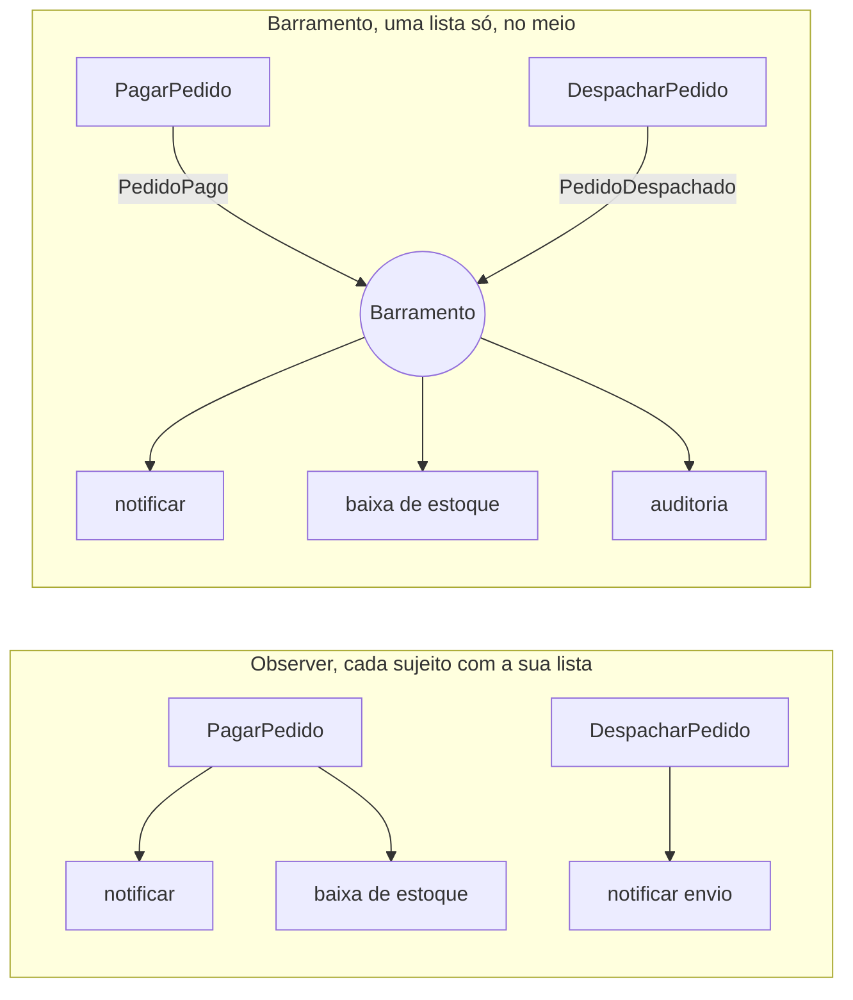

# Capítulo 21 — Fatos, não ordens (eventos de domínio)

!!! info "Situação da Empresa"

    Uma auditoria interna foi marcada para o fim do mês. A pessoa responsável fez um pedido curto: "Quero uma trilha de tudo o que acontece com um pedido, do pagamento ao envio. Quem fez, quando, qual pedido."

    O time abriu o código e viu que isso significava mexer em `PagarPedido` e em `DespacharPedido`, cada um com sua lista de observadores. "Serão dois lugares para inscrever a mesma auditoria", disse alguém. "E o próximo caso de uso, o cancelamento, vai ser o terceiro."

O Capítulo 20 terminou com uma lista de limites. Vamos resolver os quatro de uma vez, e eles têm a mesma origem: **o que o sistema anuncia não existe como coisa**. Existe uma chamada de método, `atualizar(pedido, cliente)`, que não diz o que aconteceu.

---

## O desconforto, em concreto

Para dar a trilha de auditoria completa, o Observer do capítulo anterior pediria isto:

| Para... | Seria preciso... |
|---|---|
| Auditar pagamentos | um `ObservadorDePagamento` de auditoria, inscrito em `PagarPedido` |
| Auditar envios | um `ObservadorDeDespacho` de auditoria, inscrito em `DespacharPedido` |
| Auditar o cancelamento (futuro) | um terceiro observador, em um terceiro sujeito |
| Cada sujeito | `adicionar_observador`, `remover_observador` e o laço de aviso, repetidos |

A auditoria é **uma ideia só** ("registre o que acontece com pedidos") espalhada em tantos arquivos quantos forem os acontecimentos.

---

## 🧠 Pense

1. O que a auditoria realmente quer saber: *quais objetos existem* no sistema, ou *o que aconteceu* nele?
2. Se os acontecimentos fossem objetos com nome ("pedido pago", "pedido despachado"), a auditoria poderia se inscrever em **todos** sem conhecer quem os causa?

---

## Um fato tem nome e fica no passado

!!! important "💡 Conceito — Evento de domínio"

    Um **evento de domínio** é um objeto que representa **algo que já aconteceu** no negócio e que interessa a outras partes do sistema. Tem nome no **passado** (`PedidoPago`, não `PagarPedido`), carrega os dados necessários para quem for reagir e **nunca muda**: um fato não pode ser desfeito, só seguido de outro fato.

Nosso sistema tem dois acontecimentos de pedido que já interessam a mais de uma parte. Cada um vira uma classe pequena, na camada de **domínio**, porque "o pedido foi pago" é uma afirmação sobre o negócio, não sobre a tecnologia:

```python title="ecommerce/dominio/eventos.py" linenums="1"
@dataclass(frozen=True)
class PedidoPago:
    """Fato: o pagamento de um pedido foi confirmado."""

    pedido: Pedido
    cliente: Cliente


@dataclass(frozen=True)
class PedidoDespachado:
    """Fato: um pedido pago saiu para entrega."""

    pedido: Pedido
    cliente: Cliente
    entrega: Entrega
```

O `frozen=True` impede qualquer atribuição depois da criação. Tentar `evento.cliente = outro` lança `FrozenInstanceError`. Isso é o que se espera de um fato.

!!! info "🏗️ Decisão de Projeto — o evento carrega objetos ou só identificadores?"

    Poderíamos carregar apenas `pedido_id` e `cliente_id` e deixar cada manipulador buscar o que precisa. Em sistemas maiores, é o caminho recomendado: o evento fica pequeno, não guarda estado que pode envelhecer e pode ser enviado a outro processo.

    Aqui carregamos os objetos por um motivo concreto: o `Cliente` **não é persistido** (Capítulo 17), e os manipuladores precisam do nome e do canal preferido dele. Se o `Cliente` passar a ter repositório, vale reavaliar.

---

## O intermediário: o barramento de eventos

Falta resolver quem leva o fato até quem se importa. Em vez de cada caso de uso manter uma lista, colocamos **um intermediário** entre quem anuncia e quem reage.

!!! important "💡 Conceito — Publicação e assinatura (Publisher/Subscriber)"

    Quem **publica** um evento não sabe quem vai recebê-lo. Quem **assina** não sabe quem publicou. Entre os dois fica o **barramento de eventos** (*event bus*), que guarda as assinaturas e entrega cada evento a quem se inscreveu no seu tipo.



O contrato do barramento tem duas operações. Como todo contrato que a aplicação **usa**, ele mora na camada de aplicação:

```python title="ecommerce/aplicacao/barramento_eventos.py" linenums="1"
Manipulador = Callable[[Any], None]


class BarramentoEventos(ABC):
    """Porta: por onde a aplicacao anuncia fatos e por onde quem se interessa se inscreve."""

    @abstractmethod
    def inscrever(self, tipo_evento: type, manipulador: Manipulador) -> None:
        ...

    @abstractmethod
    def publicar(self, evento: object) -> None:
        ...
```

Um **manipulador** (*handler*) é qualquer coisa que se chame com o evento: uma função ou um objeto com `__call__`. É o que o Capítulo 20 chamava de observador, agora sem uma classe base própria.

A implementação, na camada de infraestrutura, é curta:

```python title="ecommerce/infraestrutura/barramento_em_memoria.py" linenums="1"
class BarramentoEmMemoria(BarramentoEventos):
    """Entrega cada evento, na hora e no mesmo processo, a quem se inscreveu no seu tipo."""

    def __init__(self) -> None:
        self._manipuladores: dict[type, list[Manipulador]] = {}

    def inscrever(self, tipo_evento: type, manipulador: Manipulador) -> None:
        self._manipuladores.setdefault(tipo_evento, []).append(manipulador)

    def publicar(self, evento: object) -> None:
        # Tipo exato: quem se inscreveu em PedidoPago nao recebe outros eventos.
        for manipulador in list(self._manipuladores.get(type(evento), [])):
            manipulador(evento)
```

Duas características para guardar:

- É **síncrono**: `publicar` só retorna depois que todos os manipuladores terminaram. Isso mantém o fluxo fácil de seguir e de testar.
- A assinatura é pelo **tipo exato** do evento. Quem assina `PedidoPago` não recebe um evento de outro tipo.

Esta classe é um **adaptador**, no vocabulário do Capítulo 19: `BarramentoEventos` é a porta, e `BarramentoEmMemoria` encaixa nela. Trocá-lo por uma fila de mensagens real, no futuro, seria um adaptador novo na mesma porta.

---

## Os casos de uso só anunciam

Os casos de uso perdem a lista de observadores e ganham o barramento:

```python title="ecommerce/aplicacao/pagar_pedido.py" linenums="1" hl_lines="11 25"
class PagarPedido:
    """Caso de uso: confirmar o pagamento de um pedido e anunciar que ele aconteceu."""

    def __init__(
        self,
        repositorio_pedido: RepositorioPedido,
        criador_pagamento: CriadorPagamento,
        barramento: BarramentoEventos,
    ) -> None:
        self._repositorio_pedido = repositorio_pedido
        self._criador_pagamento = criador_pagamento
        self._barramento = barramento

    def executar(
        self,
        pedido_id: int,
        cliente: Cliente,
        forma: FormaPagamento = FormaPagamento.PIX,
        **dados: object,
    ) -> None:
        pedido = self._repositorio_pedido.obter(pedido_id)
        pedido.confirmar_pagamento(self._criador_pagamento, forma, **dados)
        self._repositorio_pedido.atualizar(pedido)
        self._barramento.publicar(PedidoPago(pedido, cliente))
```

`DespacharPedido` ganha a mesma forma, e o `ServicoNotificacaoPedido` deixa de ser um colaborador dele:

```python title="ecommerce/aplicacao/despachar_pedido.py" linenums="1"
    def executar(self, pedido_id: int, cliente: Cliente) -> Entrega:
        pedido = self._repositorio_pedido.obter(pedido_id)
        entrega = self._expedidor.despachar(pedido)
        self._repositorio_pedido.atualizar(pedido)
        self._barramento.publicar(PedidoDespachado(pedido, cliente, entrega))
        return entrega
```

Os dois casos de uso agora dizem **o que aconteceu**, e param por aí. Nenhum deles conhece notificação, estoque ou auditoria.

---

## Os manipuladores

Cada reação vira um manipulador pequeno, na camada de aplicação, em `aplicacao/manipuladores/`. A notificação, que no capítulo anterior era um observador só do pagamento, agora tem uma classe para cada fato:

```python title="ecommerce/aplicacao/manipuladores/notificar_cliente.py" linenums="1"
class NotificarClienteDoPagamento:
    """Reage a PedidoPago avisando o cliente pelo canal que ele prefere."""

    def __init__(self, servico_notificacao: ServicoNotificacaoPedido) -> None:
        self._servico_notificacao = servico_notificacao

    def __call__(self, evento: PedidoPago) -> None:
        self._servico_notificacao.pedido_pago(evento.pedido, evento.cliente)


class NotificarClienteDoEnvio:
    """Reage a PedidoDespachado avisando o cliente com o codigo de rastreio."""

    def __init__(self, servico_notificacao: ServicoNotificacaoPedido) -> None:
        self._servico_notificacao = servico_notificacao

    def __call__(self, evento: PedidoDespachado) -> None:
        self._servico_notificacao.pedido_enviado(evento.pedido, evento.cliente)
```

O `DarBaixaNoEstoque` mantém o que fazia, trocando `atualizar(pedido, cliente)` por `__call__(evento)`.

E a auditoria pedida no começo do capítulo é **um manipulador só**, que serve aos dois fatos. Ela escreve num `RegistroAuditoria`, outra porta da aplicação, que a infraestrutura implementa:

```python title="ecommerce/aplicacao/manipuladores/registrar_auditoria.py" linenums="1"
class RegistrarAuditoria:
    """Reage a qualquer evento de pedido deixando uma linha no registro de auditoria."""

    def __init__(self, registro: RegistroAuditoria) -> None:
        self._registro = registro

    def __call__(self, evento: PedidoPago | PedidoDespachado) -> None:
        self._registro.registrar(
            f"{type(evento).__name__}: pedido {evento.pedido.id}, cliente {evento.cliente.nome}"
        )
```

Repare que o próprio nome do evento (`type(evento).__name__`) entra na linha. É a vantagem de o aviso ter nome: o manipulador não precisa deduzir o que aconteceu.

---

## A raiz de composição liga tudo

```python title="ecommerce/composicao.py" linenums="1"
    servico_notificacao = ServicoNotificacaoPedido(CriadorNotificacao())
    barramento = BarramentoEmMemoria()
    auditoria = RegistroAuditoriaEmMemoria()

    # Quem reage a cada fato e decidido aqui, na montagem. Os casos de uso so anunciam.
    barramento.inscrever(PedidoPago, NotificarClienteDoPagamento(servico_notificacao))
    barramento.inscrever(PedidoPago, DarBaixaNoEstoque(repositorio_produto))
    barramento.inscrever(PedidoPago, RegistrarAuditoria(auditoria))
    barramento.inscrever(PedidoDespachado, NotificarClienteDoEnvio(servico_notificacao))
    barramento.inscrever(PedidoDespachado, RegistrarAuditoria(auditoria))
```

Cinco linhas dizem tudo o que o sistema faz **em reação** a um pedido. Quem quiser saber quem reage a `PedidoPago` olha para um lugar só.

---

## A prova: uma reação nova sem tocar nos casos de uso

No Capítulo 17, a prova de que o desenho estava certo foi "o serviço não muda". Aqui, a prova é que o **financeiro** passe a ser avisado dos pagamentos sem que nenhum caso de uso seja aberto:

```python title="tests/test_composicao.py" linenums="1"
def test_nova_reacao_entra_sem_tocar_nos_casos_de_uso() -> None:
    app = montar_aplicacao("memoria")
    avisos: list[str] = []
    app.barramento.inscrever(PedidoPago, lambda evento: avisos.append("financeiro avisado"))
    # ... cadastra produto, finaliza a compra ...
    app.pagar_pedido.executar(pedido.id, maria)

    assert avisos == ["financeiro avisado"]
```

Uma função anônima serviu como manipulador, e o `PagarPedido` continuou o mesmo. A auditoria completa também é conferida de ponta a ponta:

```python title="tests/test_composicao.py" linenums="1"
    assert app.auditoria.entradas() == [
        f"PedidoPago: pedido {pedido.id}, cliente Maria",
        f"PedidoDespachado: pedido {pedido.id}, cliente Maria",
    ]
```

---

## Como testar uma arquitetura de eventos

Os testes se dividem em dois tipos, e isso é uma das vantagens do desenho:

- **Quem publica.** O teste de `PagarPedido` usa um barramento *espião* que só guarda o que recebeu, e confere que o evento certo foi publicado, **depois** de o pedido estar guardado como pago. Não há notificação nem estoque no teste.
- **Quem reage.** Cada manipulador é testado sozinho, recebendo um evento montado à mão. O de estoque, por exemplo, é chamado com um `PedidoPago` e o teste confere o produto no repositório.

```python title="tests/aplicacao/test_casos_de_uso.py" linenums="1"
class BarramentoEspia(BarramentoEventos):
    def __init__(self) -> None:
        self.publicados: list[object] = []

    def inscrever(self, tipo_evento: type, manipulador: Manipulador) -> None:
        raise NotImplementedError

    def publicar(self, evento: object) -> None:
        self.publicados.append(evento)
```

O teste de arquitetura do Capítulo 19 continua verde: os manipuladores importam apenas domínio e aplicação, e o barramento em memória, que mora na infraestrutura, aponta para a porta da aplicação.

```bash
$ pytest tests/
```

??? tip "196 testes passando"

    Os testes dos observadores do capítulo anterior foram substituídos pelos dos manipuladores. Entraram os testes do barramento (entrega por tipo, ordem de inscrição, nenhum inscrito), dos eventos (imutabilidade e igualdade), do registro de auditoria, dos casos de uso publicando e dois testes de ponta a ponta: a trilha de auditoria completa e a reação nova sem editar caso de uso.

---

## Observer e evento: o que mudou de verdade

| | Observer (Cap. 20) | Barramento de eventos (este capítulo) |
|---|---|---|
| Quem guarda a lista de interessados | Cada sujeito | Um barramento, no meio |
| O que o interessado recebe | `atualizar(pedido, cliente)`, sem nome | Um evento com nome, `PedidoPago` |
| Interessado em vários acontecimentos | Implementa um observador por sujeito | Um manipulador se inscreve em vários tipos |
| Quem publica conhece quem reage? | Conhece a **lista**, mas não as classes | Conhece só o **barramento** |
| Onde se decide quem reage | Em cada sujeito, na montagem | Em um lugar, na montagem |

O evento com barramento é o mesmo Observer com **um intermediário e um nome**. O custo é pequeno, e o ganho é que o sistema passa a ter um vocabulário dos seus próprios acontecimentos.

!!! info "🏗️ Decisão de Projeto — quem publica o evento?"

    Escolhemos o **caso de uso** como publicador: depois de guardar o pedido, ele anuncia o fato. É a opção mais simples de seguir, e o evento é publicado exatamente quando o estado já está guardado.

    A alternativa, comum em projetos maiores, é a **própria entidade registrar** o evento (`pedido.eventos_pendentes`), e o caso de uso publicá-los depois de guardar. Ela garante que nenhum caminho que altere o pedido esqueça de anunciar o fato. Em troca, a entidade ganha uma lista de eventos para administrar. Para o tamanho do nosso domínio, a opção simples basta.

!!! info "📖 Nomenclatura — comando e evento"

    O Capítulo 18 disse que nossos casos de uso são *parentes* do padrão **Command**. Agora que existem eventos, a diferença fica nítida, porque comando e evento são dois lados do mesmo acontecimento:

    | | Comando | Evento |
    |---|---|---|
    | Expressa | Uma **intenção**: "quero pagar o pedido 12" | Um **fato**: "o pedido 12 foi pago" |
    | Nome | Imperativo: `PagarPedido` | Passado: `PedidoPago` |
    | Destino | **Um** só: quem executa | **Zero, um ou vários** que assinam |
    | Pode ser recusado | Sim: o pagamento pode falhar | Não: já aconteceu |

    Um comando entra no sistema; um evento sai dele. A forma fiel do padrão Command separaria os **dados** da **execução** (`PagarPedidoComando` e um *handler*). Não refatoramos o projeto para isso, mas o catálogo do bônus (Capítulo 23) volta ao assunto.

!!! warning "⚠️ Erro comum — publicar antes de guardar"

    Se o `PagarPedido` publicasse `PedidoPago` **antes** de `atualizar`, um manipulador que relesse o pedido pelo repositório o encontraria ainda como não pago. Um evento só pode ser publicado depois que o fato que ele descreve estiver guardado.

!!! warning "⚠️ Erro comum — evento com nome de ordem"

    `PagarPedido` é uma **intenção** ("quero que o pedido seja pago"). `PedidoPago` é um **fato**. Se o nome do evento está no imperativo, a classe está dizendo a alguém o que fazer, e o publicador volta a depender de quem executa. O nome no passado é o que mantém o evento como informação, e não como instrução.

---

## 🧩 Aplicando ao Projeto Financeiro

1. Defina os eventos do seu domínio: `LancamentoRegistrado` e, se fizer sentido, `MetaAtingida`. Escreva-os como `@dataclass(frozen=True)`, com nome no passado.
2. Crie um barramento (a porta na aplicação, a implementação em memória na infraestrutura) e faça `RegistrarLancamento` apenas **publicar** `LancamentoRegistrado`.
3. Transforme o alerta de meta estourada, que no capítulo anterior era um observador, em um manipulador de `LancamentoRegistrado`. Acrescente um segundo manipulador (um registro de auditoria, por exemplo) **sem abrir o caso de uso**.

Documente: o que o evento precisou carregar para os manipuladores conseguirem trabalhar? Você carregou objetos ou identificadores? Por quê?

---

## 🎯 Exercícios

**Nível 1.** Crie o evento `EstoqueBaixou(produto_id, restante)` e um manipulador que registre na auditoria quando o estoque de um produto chegar a zero. Onde o evento deve ser publicado: no caso de uso, ou no manipulador de estoque? Justifique.

**Nível 2.** Os manipuladores recebem o evento por `__call__`. Reescreva `RegistrarAuditoria` como uma **função** que recebe o registro por *closure* (uma função que devolve a função). Compare: o que ficou mais simples? O que ficou menos claro?

**🚀 Desafio.** Imagine que o barramento deva entregar eventos também a quem se inscreveu na **classe base** (por exemplo, um `EventoDePedido` do qual `PedidoPago` e `PedidoDespachado` herdam). Altere `BarramentoEmMemoria` e a auditoria para usar isso. Que decisão você tomou sobre a ordem de entrega?

---

## 📌 Resumo

- O Observer clássico deixava quatro problemas: lista repetida em cada sujeito, observador preso a um sujeito, composição trabalhosa e aviso sem nome
- Um **evento de domínio** é um fato imutável, com nome no passado (`PedidoPago`), na camada de domínio
- O **barramento de eventos** é um intermediário: quem publica não conhece quem assina, e quem assina não conhece quem publicou
- A porta `BarramentoEventos` mora na aplicação; `BarramentoEmMemoria` é um adaptador da infraestrutura, síncrono e com assinatura por tipo exato
- Os casos de uso apenas **anunciam** o fato, depois de guardar o estado
- Cada reação é um **manipulador** pequeno, e a raiz de composição decide quem assina o quê
- Quem publica e quem reage são testados separadamente, com um barramento espião e eventos montados à mão
- Um evento é um fato, não uma ordem: o nome vai no passado

## O que mudou no sistema

- ✔ `PedidoPago` e `PedidoDespachado` existem como fatos; os casos de uso só os publicam
- ✔ Notificação, baixa de estoque e **auditoria** são manipuladores, inscritos em um único lugar
- ✔ Uma reação nova entra sem abrir nenhum caso de uso
- ✔ A regra de dependência continua verificada por testes
- ❌ Um manipulador que falha ainda derruba os seguintes e faz o `executar` parecer ter falhado
- ❌ Só os testes executam o sistema: não há nenhuma forma de **usá-lo** de fora

## O que vem a seguir

Com os eventos no lugar, o `PagarPedido` ficou limpo, e o sistema tem tudo o que um domínio precisa: regras, variações, criação, persistência, camadas, reações. Mas quando a diretoria pediu para **ver uma compra acontecer**, o time descobriu um buraco: só os testes executam o sistema. Não existe um arquivo que se rode, nem um menu, nem uma tela.

O próximo capítulo constrói a **porta de entrada**: um cenário com dados fixos e um menu de terminal, e mostra como a mesma ideia serviria a uma API REST. É também onde o sistema enfrenta o primeiro cenário que dá errado, e onde a falha de uma reação precisa ser tratada.
