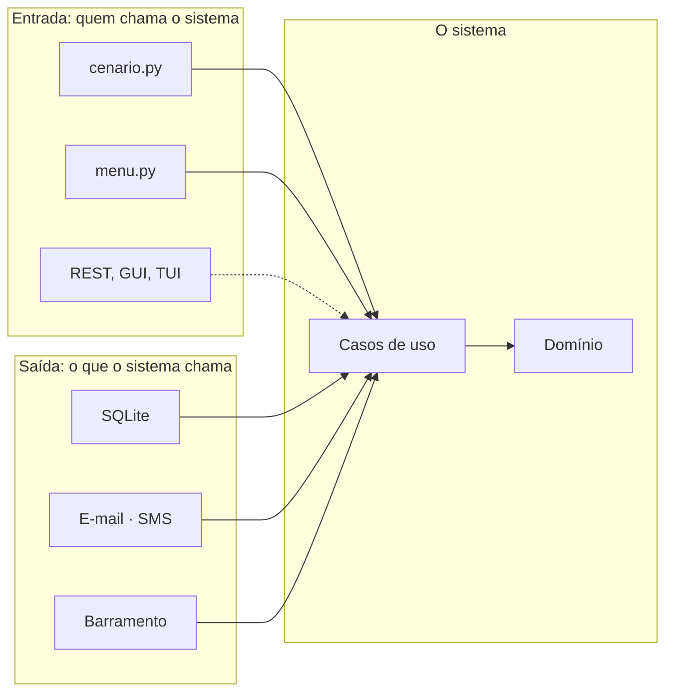

# Capítulo 22 — Colocando o sistema para rodar

!!! info "Situação da Empresa"

    A diretoria pediu uma demonstração: "Quero ver uma compra acontecer, do carrinho ao envio. Pode ser agora de manhã?"

    O time hesitou. O sistema tem casos de uso, repositórios, eventos, mais de duzentos testes verdes. Mas, olhando a pasta, ninguém soube dizer **qual arquivo se executa** para mostrar uma compra. "A gente roda os testes", alguém sugeriu. A diretoria não achou graça.

Construímos um sistema inteiro sem nunca o **usar**. Quem o exercita são os testes e alguns blocos `if __name__ == "__main__"` espalhados, cada um mostrando um pedaço. Falta o que existe em todo software: uma **porta de entrada**.

---

## O problema, concretamente

Quando o programa deixa de ser uma biblioteca e passa a ser algo que alguém **usa**, aparecem perguntas que os casos de uso não respondem:

- Quem decide **quais dados** entram: um script fixo, alguém digitando, uma requisição na rede?
- Quem **monta** o sistema (a raiz de composição) e o entrega a esse alguém?
- O que acontece com uma **exceção**: ela precisa virar uma mensagem que a pessoa entenda?

Os casos de uso foram escritos para não saber nada disso. `PagarPedido.executar(pedido_id, cliente)` não sabe se o `pedido_id` veio de um teclado, de um arquivo ou de uma URL.

---

## 🧠 Pense

1. Se amanhã a diretoria pedir um site, depois um aplicativo de celular, quanto do sistema deveria mudar?
2. Onde deve morar o código que lê o que a pessoa digitou e escreve o que ela vê: no domínio, na aplicação ou em um lugar novo?

---

## O ponto de entrada

!!! important "💡 Conceito — Ponto de entrada (adaptador de entrada)"

    Um **ponto de entrada** é o código que fica entre o mundo de fora e os casos de uso: ele recebe o que vem de uma interface (teclado, tela, requisição de rede), chama o caso de uso certo e devolve o resultado na linguagem dessa interface.

    No vocabulário do Capítulo 19, é um **adaptador de entrada**. Até agora só tínhamos adaptadores de **saída**: SQLite, e-mail, SMS, o barramento. Eram coisas que o sistema **chama**. O ponto de entrada é o oposto: é quem **chama** o sistema.



Leia as setas como nos capítulos anteriores: nenhuma sai do centro para fora. A entrada aponta para os casos de uso, e a infraestrutura continua apontando para os contratos que a aplicação define. A interface é um **detalhe**, como o banco e o ORM: pode-se trocar sem mexer no que está no centro.

---

## Uma quarta camada

O código de entrada ganha uma pasta própria, ao lado das outras:

```text
ecommerce/
├── dominio/
├── aplicacao/
├── infraestrutura/
├── entrada/            ← novo
│   ├── cenario.py
│   └── menu.py
└── composicao.py
```

A regra de quem pode importar quem fica assim:

| Camada | Pode importar | Não pode importar |
|---|---|---|
| `dominio/` | ninguém | todas as outras |
| `aplicacao/` | `dominio/` | `infraestrutura/`, `entrada/` |
| `infraestrutura/` | `dominio/`, `aplicacao/` | `entrada/` |
| `entrada/` | `dominio/`, `aplicacao/` e a **raiz de composição** | `infraestrutura/` |

Uma novidade merece atenção: a entrada **não conhece a infraestrutura**. Quem escolhe SQLite ou memória é a raiz de composição, e a entrada só pede o sistema montado. Dois testes novos de arquitetura guardam isso:

```python title="tests/test_arquitetura.py" linenums="1"
def test_entrada_nao_conhece_a_infraestrutura() -> None:
    # A entrada usa a raiz de composicao, que e quem conhece as implementacoes.
    assert "infraestrutura" not in _camadas_importadas("entrada")


def test_nenhuma_camada_interna_importa_a_entrada() -> None:
    for camada in ("dominio", "aplicacao", "infraestrutura"):
        assert "entrada" not in _camadas_importadas(camada), camada
```

---

## Consultar também é um caso de uso

Para mostrar uma compra, a entrada precisa **ler** o sistema: listar produtos, ver o status de um pedido. Seria tentador chamar o repositório direto, mas isso faria a entrada conhecer um contrato do domínio que os casos de uso existem para esconder. Duas consultas simples resolvem:

```python title="ecommerce/aplicacao/consultar_pedido.py" linenums="1"
class ConsultarPedido:
    """Caso de uso de consulta: em que pe esta um pedido."""

    def __init__(self, repositorio_pedido: RepositorioPedido) -> None:
        self._repositorio_pedido = repositorio_pedido

    def executar(self, pedido_id: int) -> Pedido:
        return self._repositorio_pedido.obter(pedido_id)
```

`ListarProdutos` tem a mesma forma. A raiz de composição passa a entregar os dois em `Aplicacao`, junto dos casos de uso que já existiam.

---

## O sistema montado: `Aplicacao`

A entrada não cria casos de uso nem repositórios. Ela recebe o sistema **pronto**, entregue pela raiz de composição. Desde o Capítulo 18, `montar_aplicacao()` devolve um objeto `Aplicacao`, que é só uma bandeja com tudo o que a entrada pode usar:

```python title="ecommerce/composicao.py" linenums="1"
@dataclass
class Aplicacao:
    produtos: RepositorioProduto
    cadastrar_produto: CadastrarProduto
    finalizar_compra: FinalizarCompra
    pagar_pedido: PagarPedido
    despachar_pedido: DespacharPedido
    listar_produtos: ListarProdutos
    consultar_pedido: ConsultarPedido
    barramento: BarramentoEventos
    auditoria: RegistroAuditoria
```

Os casos de uso (`finalizar_compra`, `pagar_pedido`...) são o que a entrada chama. `produtos`, `barramento` e `auditoria` ficam à mão para testes e demonstrações: o cenário usa a auditoria para mostrar o que aconteceu. A montagem em si, com o `if` entre memória e SQLite, os manipuladores inscritos no barramento e o tratamento de falhas, está toda em `montar_aplicacao()`. É o único lugar que conhece as três camadas.

Daqui em diante, tudo o que a entrada faz é receber um `Aplicacao` e chamar o que está nele.

---

## O cenário fixo

O primeiro ponto de entrada é o mais simples: um script que conta uma história, sempre a mesma, com **dados fixos**. Ele serve para demonstrar, para depurar e para ver o sistema funcionando antes de existir qualquer interface.

```python title="ecommerce/entrada/cenario.py" linenums="1"
def cenario_compra(app: Aplicacao, saida: Saida = print) -> None:
    """Uma compra do inicio ao fim, com dados fixos."""
    saida("== Cenario 1: uma compra do inicio ao fim ==")
    notebook = app.cadastrar_produto.executar("Notebook", 3500.0, 5, "Informática")
    mouse = app.cadastrar_produto.executar("Mouse", 150.0, 20, "Informática")
    _mostrar_estoque(app, saida, "Estoque antes")

    maria = _cliente_com("Maria", "maria@email.com", (notebook, 1), (mouse, 2))
    pedido = app.finalizar_compra.executar(maria)
    saida(f"Maria finalizou a compra: pedido {pedido.id}, R$ {pedido.calcular_total():.2f}")

    app.pagar_pedido.executar(pedido.id, maria)
    saida(f"Status apos pagar: {app.consultar_pedido.executar(pedido.id).status}")
    app.despachar_pedido.executar(pedido.id, maria)
    saida(f"Status apos despachar: {app.consultar_pedido.executar(pedido.id).status}")

    _mostrar_estoque(app, saida, "Estoque depois")
    _mostrar_auditoria(app, saida)
```

Repare em dois detalhes. O cenário recebe o sistema **pronto** (`app`) e não o monta: quem monta é o `main.py`, que veremos já. E ele escreve por uma função `saida`, que por padrão é `print`. Isso permite que o teste passe uma lista no lugar e confira o que seria impresso.

Para rodar:

```bash
$ python main.py --cenario compra
```

```text
== Cenario 1: uma compra do inicio ao fim ==
Estoque antes:
  Notebook: 5
  Mouse: 20
Maria finalizou a compra: pedido 1, R$ 3800.00
[E-MAIL -> maria@email.com] Ola, Maria. O pagamento do seu pedido foi confirmado. Total: R$ 3800.00.
Status apos pagar: pago
[E-MAIL -> maria@email.com] Ola, Maria. Seu pedido foi enviado. Codigo de rastreio: BR000001SE.
Status apos despachar: enviado
Estoque depois:
  Notebook: 4
  Mouse: 18
Auditoria:
  PedidoPago: pedido 1, cliente Maria
  PedidoDespachado: pedido 1, cliente Maria
```

Tudo o que construímos nos últimos três módulos aparece nessa saída: o pedido guardado e relido, a notificação, a baixa de estoque, a trilha de auditoria. Cada linha é um caso de uso ou um manipulador de evento fazendo o seu trabalho.

---

## O menu de terminal

O cenário conta uma história fixa. O segundo ponto de entrada deixa **a pessoa** conduzir: um menu no terminal, só com a biblioteca padrão.

```python title="ecommerce/entrada/menu.py" linenums="1" hl_lines="3-4 7-8"
class Menu:
    """Menu de terminal: traduz o que a pessoa digita em chamadas aos casos de uso.

    `entrada` e `saida` chegam de fora, como qualquer outra dependencia:
    nos testes, uma sessao roteirizada; no terminal, `input` e `print`.
    """

    def __init__(
        self,
        app: Aplicacao,
        entrada: Callable[[str], str] = input,
        saida: Callable[[str], None] = print,
    ) -> None:
        ...
```

`entrada` e `saida` são **dependências injetadas**, como o relógio que vimos nos capítulos anteriores ou o repositório do Capítulo 16. Em uso real, são `input` e `print`. No teste, são uma sessão escrita de antemão:

```python title="tests/entrada/test_menu.py" linenums="1"
class Roteiro:
    """Uma sessao de terminal escrita de antemao: cada chamada devolve a proxima resposta."""

    def __init__(self, *respostas: str) -> None:
        self._respostas = iter([*respostas, "0"])

    def __call__(self, pergunta: str) -> str:
        return next(self._respostas)


def test_fluxo_completo_pelo_menu(app) -> None:
    linhas = _rodar(app, "2", "1", "2", "3", "4", "1", "5", "1", "6", "1")
    assert "2 x Notebook no carrinho." in linhas
    assert "Pedido 1 criado: R$ 7000.00" in linhas
    assert "Pagamento do pedido 1 confirmado." in linhas
    assert "Pedido 1: enviado, 1 item(ns), R$ 7000.00" in linhas
```

Cada dupla de respostas faz parte de uma ação: `"2", "1", "2"` é "colocar no carrinho" (opção 2), produto 1, quantidade 2. Sem nenhum teclado envolvido, o teste percorre o fluxo inteiro, do carrinho ao envio.

### Traduzindo erros

O terceiro ponto importante do menu é o que ele faz com as exceções. Um `PedidoNaoEncontradoError` com um traceback de dez linhas não ajuda quem digitou o número errado. A entrada é a **fronteira** do sistema, e é nela que os erros viram a linguagem do meio:

```python title="ecommerce/entrada/menu.py" linenums="1"
    def _executar_com_seguranca(self, acao: Callable[[], None]) -> None:
        # Fronteira do sistema: as excecoes viram mensagens na linguagem do terminal.
        try:
            acao()
        except (ValueError, PedidoNaoEncontradoError, ProdutoNaoEncontradoError) as erro:
            self._saida(f"Erro: {erro}")
```

Uma sessão com erros, vista de dentro (o menu das opções foi omitido):

```text
Opcao: 4
Id do pedido: 99
Erro: Pedido 99 nao encontrado
Opcao: 4
Id do pedido: abc
Erro: digite um numero inteiro
Opcao: 3
Erro: Carrinho vazio
```

Os casos de uso lançaram as mesmas exceções de sempre. O menu só as traduziu. Guarde esta ideia, porque ela volta na próxima seção.

O cliente é fixo (Maria) e o carrinho vive só durante a sessão. O catálogo inicial é cadastrado **somente se a loja estiver vazia**. Isso importa quando o menu roda com um arquivo SQLite: ao abrir de novo, os produtos já estão lá, e o menu não os duplica.

---

## Um só ponto de partida: `main.py`

O cenário e o menu são duas formas de usar o sistema, e a pessoa não deveria precisar decorar dois programas. Na raiz do projeto, ao lado da pasta `ecommerce/`, fica o arquivo que **se executa**:

```python title="main.py" linenums="1"
def main(argv=None, entrada=input, saida=print) -> None:
    parser = argparse.ArgumentParser(description="E-Commerce: cenarios fixos ou menu de terminal.")
    parser.add_argument("modo", nargs="?", choices=["cenario", "menu"], default="cenario")
    parser.add_argument("--armazenamento", choices=["memoria", "sqlite"], default="sqlite")
    parser.add_argument("--banco", default=":memory:", help="arquivo SQLite (padrao: memoria)")
    parser.add_argument("--cenario", choices=[*CENARIOS, "todos"], default="todos")
    args = parser.parse_args(argv)

    if args.modo == "menu":
        app = montar_aplicacao(args.armazenamento, args.banco)
        preparar_produtos(app)
        Menu(app, entrada, saida).executar()
        return

    nomes = list(CENARIOS) if args.cenario == "todos" else [args.cenario]
    for nome in nomes:
        # Cada cenario recebe um sistema novo, montado do zero.
        app = montar_aplicacao(args.armazenamento, args.banco)
        CENARIOS[nome](app, saida)
        saida("")
```

Ele faz três coisas e nenhuma delas é regra de negócio: lê os argumentos, pede o sistema montado e entrega ao cenário ou ao menu. As combinações possíveis:

| Comando | O que faz |
|---|---|
| `python main.py` | Roda **todos** os cenários, com dados fixos, em SQLite na memória |
| `python main.py --cenario compra` | Roda só a compra do início ao fim |
| `python main.py --cenario ultima-unidade` | Roda só a história de Ana e Bia |
| `python main.py --armazenamento memoria` | O mesmo, com repositórios em memória |
| `python main.py menu` | Abre o menu de terminal |
| `python main.py menu --banco loja.db` | Abre o menu guardando os dados em um arquivo |
| `python main.py --help` | Lista tudo isso |

A saída que você viu nas seções anteriores é a de `python main.py`, sem nenhum argumento. E o argumento `--armazenamento` é a raiz de composição trabalhando à vista: o cenário é o mesmo nos dois casos, e nenhuma linha dele sabe se os dados estão na memória ou em um arquivo.

Como `entrada` e `saida` também chegam por parâmetro, o próprio `main` é testável sem teclado nem tela.

### Rodando duas vezes sobre o mesmo arquivo

Com `--banco`, o SQLite grava em um arquivo, e dá para ver os dados sobreviverem ao fim do programa. Na primeira execução, uma pessoa digita (o que ela escreve vem depois de `Opcao:`):

```bash
$ python main.py menu --banco loja.db
```

```text
1. Listar produtos
...
Opcao: 2
Id do produto: 1
Quantidade: 1
1 x Notebook no carrinho.
Opcao: 3
Pedido 1 criado: R$ 3500.00
Opcao: 0
Ate logo.
```

O programa terminou. Rodando de novo, o processo é outro, mas o catálogo e o pedido continuam no arquivo:

```bash
$ python main.py menu --banco loja.db
```

```text
Opcao: 1
1. Notebook - R$ 3500.00 (estoque 5)
2. Mouse - R$ 150.00 (estoque 20)
3. Teclado - R$ 250.00 (estoque 10)
Opcao: 6
Id do pedido: 1
Pedido 1: criado, 1 item(ns), R$ 3500.00
Opcao: 0
Ate logo.
```

O catálogo não foi duplicado (`preparar_produtos` só cadastra com a loja vazia), e o pedido 1 foi relido do banco com seus itens. Este é exatamente o fluxo que o teste `test_menu_com_arquivo_guarda_os_dados_entre_duas_execucoes` percorre, com um arquivo temporário.

Mas repare no que **não** voltou: o carrinho de Maria. Ele vivia só na memória da primeira sessão. É a lacuna que a seção sobre persistência trata mais adiante.

---

## E se fosse REST, GUI ou TUI?

Tudo o que vimos até aqui **roda e tem teste**: o cenário, o menu e o `main.py` são código real. O que vem agora é diferente: é só um **esboço**, escrito para mostrar o caminho.

Um menu de terminal é o ponto de entrada mais simples possível. Em muitos projetos, a interface é uma **API REST**, uma **janela** ou uma **tela de terminal mais elaborada** (uma TUI). A boa notícia é que nada em `dominio/` nem em `aplicacao/` precisaria mudar. Veja como um esboço de REST com FastAPI se pareceria. **Este, sim, não está no código do capítulo, não é executado e não tem testes.**

```python title="entrada/api.py (esboço, nao executado)" linenums="1"
app = FastAPI()
casos = montar_aplicacao("sqlite", "loja.db")        # montado uma vez, na partida


@app.get("/produtos")
def listar_produtos():
    return [
        {"id": p.id, "nome": p.nome, "preco": p.preco, "estoque": p.quantidade_estoque}
        for p in casos.listar_produtos.executar()
    ]


@app.post("/pedidos/{pedido_id}/pagamento", status_code=204)
def pagar(pedido_id: int):
    casos.pagar_pedido.executar(pedido_id, cliente_da_requisicao())   # ?


@app.exception_handler(PedidoNaoEncontradoError)
def pedido_nao_encontrado(requisicao, erro):
    return JSONResponse(status_code=404, content={"erro": str(erro)})
```

A estrutura é a mesma do menu: chamar o caso de uso e traduzir as exceções. Para uma **GUI** ou uma **TUI**, a ideia também não muda: a tela chama os mesmos casos de uso. Mas o esboço deixa quatro perguntas em aberto, e cada uma aponta para uma lacuna do nosso sistema:

| Ponto de contato | O que a interface precisa | O que o sistema tem hoje |
|---|---|---|
| **Quem é o cliente?** | Identificar quem faz a requisição | O `Cliente` **não é persistido**, e os casos de uso recebem o objeto, não um identificador (a linha com `?` acima) |
| **Serializar a resposta** | Transformar `Pedido` ou `Produto` em JSON | O domínio não vira JSON sozinho. É preciso montar um formato de resposta à parte (um DTO), para não vazar a estrutura interna |
| **Exceção em status HTTP** | `PedidoNaoEncontradoError` vira 404, `ValueError` vira 422 | A mesma tradução que o menu já faz, só que para outro vocabulário |
| **Conexão e threads** | Uma conexão por requisição, ou um pool | O `sqlite3` recusa usar uma conexão em outra *thread*; um servidor web usa várias |

Os dois últimos itens são o que a camada de entrada resolve. Os dois primeiros mostram que **o domínio ainda é um recorte**, o que nos leva à seção seguinte.

---

## O que ainda não está persistido

Desde o Capítulo 17 o sistema guarda dados em SQLite. Mas guarda **apenas uma parte** deles:

| Persistido em SQLite | Só em memória (some quando o programa termina) |
|---|---|
| `Produto` | `Cliente` |
| `Pedido` | `Carrinho` |
| `ItemPedido` | `Pagamento`, `Entrega`, `Cupom` |
| | O registro de auditoria |
| | Os eventos |

O `main.py menu --banco loja.db` torna essa lacuna fácil de enxergar. Reinicie o menu e o catálogo e os pedidos continuam lá, porque estão no arquivo. Mas o cliente e o carrinho recomeçam do zero. Um pedido relido do banco volta **sem pagamento, sem entrega e sem cupom**, e a auditoria do dia anterior se perdeu.

!!! warning "⚠️ Isto é um recorte didático, e não um sistema completo"

    Persistimos apenas o suficiente para ensinar Repository, mapeamento e camadas. Um sistema real precisaria persistir **tudo**: também o `Cliente`, o `Carrinho`, o `Pagamento` (com a forma escolhida e os dados dela), a `Entrega`, o `Cupom`, a auditoria e até os eventos. O `Pedido` passaria a referenciar o `Cliente`.

    Isso traz custos concretos: mais tabelas, o mapeamento de hierarquias (cada forma de pagamento e cada meio de entrega é uma subclasse), chaves estrangeiras, e a **evolução do esquema** conforme o sistema muda (as migrações).

Escrever tudo isso à mão, como fizemos para dois repositórios, significa um `INSERT`, um `UPDATE`, um `SELECT` e um mapeador para **cada classe**. Com meia dúzia de tabelas, vira trabalho repetitivo e fácil de errar. É nesse ponto que um **ORM** (como o SQLAlchemy) passa a compensar: ele gera o SQL e administra o mapeamento, e uma ferramenta de migração (como o Alembic) cuida da evolução do esquema.

A regra que vimos nos Capítulos 17 e 19 continua valendo: o ORM seria **mais um adaptador** do mesmo contrato de repositório, dentro de `infraestrutura/`, de preferência em mapeamento *imperativo* (que registra as classes sem alterá-las), para o domínio seguir sem importar a biblioteca. Um critério prático para decidir: quando o número de classes e de consultas cresce, ou quando mudar o esquema vira rotina.

Na entrega final, o seu Projeto Financeiro precisa persistir os dados **principais** do seu domínio. O documento de decisões deve dizer o que ficou de fora e o que seria preciso para completá-lo.

---

## O primeiro cenário que dá errado

O `main` do cenário tem um segundo caso, que você pode rodar agora:

```bash
$ python main.py --cenario ultima-unidade
```

É a história de **Ana e Bia**: duas pessoas colocam no carrinho o último notebook em estoque, as duas finalizam a compra, e as duas pagam. O catálogo tem uma unidade só.

```text
== Cenario 2: duas pessoas, uma unica unidade ==
Ana e Bia finalizaram a compra do mesmo notebook. Estoque: 1.
[E-MAIL -> ana@email.com] Ola, Ana. O pagamento do seu pedido foi confirmado. Total: R$ 3500.00.
[E-MAIL -> bia@email.com] Ola, Bia. O pagamento do seu pedido foi confirmado. Total: R$ 3500.00.
Pedido de Ana: pago
Pedido de Bia: pago
Estoque depois:
  Notebook: 0
Auditoria:
  PedidoPago: pedido 1, cliente Ana
  FALHA: DarBaixaNoEstoque nao tratou PedidoPago (EstoqueInsuficienteError: Estoque de Notebook: restam 0, solicitado 1)
  PedidoPago: pedido 2, cliente Bia
```

Duas pessoas pagaram por um produto que só existia uma vez, e o sistema registrou os dois pagamentos. A linha de **FALHA** na auditoria é a pista: quando o pedido da Bia foi pago, a reação `DarBaixaNoEstoque` tentou tirar uma unidade que não existia mais.

Antes de entender por que essa falha não derrubou o resto, vale ver o que **aconteceria** sem o cuidado que a montagem já tem. No Capítulo 21, o barramento propaga o erro de um manipulador, e o fluxo seria este:

| Passo | O que acontece | Estado depois |
|---|---|---|
| 1 | O pedido da Bia é confirmado e **guardado como pago** | Pedido: pago |
| 2 | `NotificarClienteDoPagamento` avisa Bia: "pagamento confirmado" | Bia foi avisada de que está tudo certo |
| 3 | `DarBaixaNoEstoque` tenta tirar uma unidade e lança `EstoqueInsuficienteError` | Estoque: 0, e a baixa não foi feita |
| 4 | O erro **sobe** pelo barramento e pelo `PagarPedido`, e chega a quem chamou | Bia vê uma mensagem de erro |
| 5 | `RegistrarAuditoria` **nunca roda** | Nenhuma trilha do pagamento de Bia |

O sistema contaria **três versões** da mesma história: o banco diz "pago", a notificação diz "confirmado", e a tela diz "erro". O problema é que o erro de uma *reação* seria tratado como erro do *fato*.

### Três posturas diante de uma reação que falha

Não existe uma resposta única. Existem três posturas, cada uma para um tipo de situação:

| Postura | O que faz | Quando usar |
|---|---|---|
| **Propagar** | O erro sobe, os manipuladores seguintes não rodam | Quando a reação **faz parte** da operação: se falhou, o fato não deveria valer |
| **Isolar e registrar** | Cada manipulador falha sozinho; o erro é anotado; os outros continuam | Quando o fato **já é verdade** e as reações são independentes entre si |
| **Repetir ou compensar** | Tentar de novo mais tarde, ou desfazer o efeito | Quando a reação precisa acontecer de qualquer jeito. Exige cuidados extras, e fica fora deste curso |

Um pagamento confirmado é um **fato consumado**: o dinheiro já saiu da conta. A notificação, a baixa e a auditoria são reações a ele. A segunda postura é a que se encaixa, e é a que o cenário acima mostra funcionando.

### Isolar: o barramento aprende a falhar

A implementação é pequena. O barramento ganha uma função opcional, `ao_falhar`, chamada quando um manipulador lança uma exceção:

```python title="ecommerce/infraestrutura/barramento_em_memoria.py" linenums="1" hl_lines="1 10-11 17-23"
AoFalhar = Callable[[object, Manipulador, Exception], None]


class BarramentoEmMemoria(BarramentoEventos):
    """Entrega cada evento, na hora e no mesmo processo, a quem se inscreveu no seu tipo.

    Sem `ao_falhar`, o erro de um manipulador sobe para quem publicou e os manipuladores
    seguintes nao rodam. Com `ao_falhar`, o erro e entregue a essa funcao e os
    seguintes continuam: uma reacao que falha nao derruba as outras.
    """

    def __init__(self, ao_falhar: AoFalhar | None = None) -> None:
        self._manipuladores: dict[type, list[Manipulador]] = {}
        self._ao_falhar = ao_falhar

    def publicar(self, evento: object) -> None:
        for manipulador in list(self._manipuladores.get(type(evento), [])):
            try:
                manipulador(evento)
            except Exception as erro:
                if self._ao_falhar is None:
                    raise
                self._ao_falhar(evento, manipulador, erro)
```

O comportamento **padrão** continua sendo propagar: quem criar um barramento sem `ao_falhar` não terá nenhuma falha engolida sem ter pedido. O isolamento é uma escolha explícita, e quem escolhe é a **raiz de composição**, que também decide o que fazer com a falha: registrar no log e na auditoria.

```python title="ecommerce/composicao.py" linenums="1"
    def registrar_falha(evento: object, manipulador: Manipulador, erro: Exception) -> None:
        # O fato ja aconteceu: a falha de uma reacao nao desfaz o pagamento.
        # Fica registrada para alguem olhar depois.
        mensagem = (
            f"FALHA: {_nome_de(manipulador)} nao tratou {type(evento).__name__} "
            f"({type(erro).__name__}: {erro})"
        )
        auditoria.registrar(mensagem)
        registrar(mensagem)

    barramento = BarramentoEmMemoria(ao_falhar=registrar_falha)
```

Por padrão, `registrar` escreve um *warning* no log do Python, e por isso você verá a mesma mensagem de falha aparecer no terminal, além de na auditoria.

O teste de ponta a ponta cobre o cenário nas duas configurações de armazenamento:

```python title="tests/test_composicao.py" linenums="1"
    app.pagar_pedido.executar(pedido_da_ana.id, ana)
    app.pagar_pedido.executar(pedido_da_bia.id, bia)  # a ultima unidade ja foi

    assert app.produtos.obter(ultimo.id).quantidade_estoque == 0
    entradas = app.auditoria.entradas()
    assert f"PedidoPago: pedido {pedido_da_bia.id}, cliente Bia" in entradas
    falhas = [e for e in entradas if e.startswith("FALHA")]
    assert len(falhas) == 1
    assert "DarBaixaNoEstoque" in falhas[0]
```

E o barramento é testado, sozinho, nas duas posturas:

```python title="tests/infraestrutura/test_barramento_em_memoria.py" linenums="1"
def test_sem_ao_falhar_o_erro_sobe_e_os_seguintes_nao_rodam() -> None: ...

def test_com_ao_falhar_os_seguintes_continuam() -> None: ...

def test_ao_falhar_recebe_o_evento_o_manipulador_e_o_erro() -> None: ...
```

```bash
$ pytest tests/
```

??? tip "234 testes passando"

    Os 196 do Capítulo 21 continuam verdes. Entraram os testes das duas consultas, dos dois cenários, do menu (sessões roteirizadas, erros traduzidos, opção inválida), do `main.py` (inclusive o que roda o menu duas vezes sobre o mesmo arquivo SQLite), dos dois testes de arquitetura da camada de entrada e os de falha de reações (quatro do barramento e o de ponta a ponta, que roda com memória e com SQLite).

### O que ainda não está resolvido

Isolar a falha impediu que o erro contaminasse tudo. Mas o problema de fundo continua: **o pagamento e a baixa não acontecem juntos**. Existe uma janela em que o pedido está pago e o estoque ainda não baixou, e, no caso da Bia, ela nunca se fecha sozinha. Isso liga com o Capítulo 17: cada repositório guarda suas mudanças em uma transação própria, e o pagamento foi confirmado (`COMMIT`) antes de o primeiro manipulador ser chamado. É o que se chama de **consistência eventual**: por um tempo, as partes do sistema não concordam, e algo precisa trazê-las de volta à concordância.

Três observações para fechar:

- **A falha deve ser vista.** A linha `FALHA` só ajuda se alguém a lê. Num sistema real, ela dispararia um alerta ou entraria numa lista de pendências para reprocessar.
- **Repetir não é de graça.** Se alguém reprocessar o evento da Bia depois de repor o estoque, o `DarBaixaNoEstoque` **não é idempotente**: rodado duas vezes sobre o mesmo evento, dá baixa duas vezes. Repetir com segurança exige que o manipulador reconheça que já tratou aquele evento.
- **O erro de verdade está antes.** O problema da Bia não é um manipulador: é o sistema ter aceitado **vender o que não tinha**. Nem `Carrinho` nem `FinalizarCompra` verificam o estoque. Um registro de falha é um remendo; a regra "não aceite pedidos sem estoque" pertence ao domínio, no momento da compra.

!!! warning "⚠️ Erro comum — isolar para esconder"

    Isolar a falha e registrá-la em um lugar que ninguém olha é o mesmo que ignorá-la. A decisão de isolar só é boa **junto com** a decisão de quem vai ver o registro e o que fazer com ele.

!!! warning "⚠️ Erro comum — usar eventos para o que precisa ser atômico"

    Se duas coisas **precisam** acontecer juntas, ou nenhuma (por exemplo, debitar uma conta e creditar outra), elas não devem ser ligadas por um evento. Evento é para o que vem **depois** de um fato consumado. O que precisa ser atômico pertence à mesma transação, dentro do mesmo caso de uso.

---

## 🧩 Aplicando ao Projeto Financeiro

1. Crie um **`main.py`** para o seu projeto, e um **cenário com dados fixos**: algumas categorias, um punhado de lançamentos, uma meta que estoura. Ele deve imprimir o que o sistema fez.
2. Crie um **ponto de entrada interativo**: um menu de terminal como o deste capítulo (ou, se preferir, um esboço de REST). A interface deve ficar fora das camadas internas e só chamar os casos de uso.
3. Traduza as exceções do seu sistema para mensagens na linguagem da interface que você escolheu.
4. Provoque uma falha: faça o alerta de meta estourada lançar uma exceção. O que acontece hoje com o registro do lançamento? Escolha uma postura (propagar ou isolar) e **justifique por escrito**. Se isolar, onde o erro fica registrado e quem vai olhar?
5. Faça uma lista do que o seu sistema **persiste** e do que **não persiste**. O que precisaria entrar para ficar completo?

Documente: o que a interface precisou saber que os casos de uso não sabiam? Você precisou mudar algo nas camadas internas para encaixá-la?

---

## 🎯 Exercícios

**Nível 1.** Acrescente a opção "Cancelar pedido" ao menu. Isso exige um caso de uso novo. Em que camada ele fica, e em que camada fica a mudança no menu? Quantos arquivos você tocou?

**Nível 2.** Rode `python main.py --banco loja.db` duas vezes seguidas. O que acontece com o catálogo? Por quê? E o que o `menu` faz de diferente para evitar o mesmo problema?

**Nível 3.** Corrija a causa do problema da Bia: faça `FinalizarCompra` recusar um pedido cujo item excede o estoque (lançando `EstoqueInsuficienteError`). O que acontece com duas pessoas que finalizam a compra da **última unidade** antes de qualquer pagamento? A verificação na compra resolve esse caso? Se não, o que seria necessário (uma reserva)?

**🚀 Desafio.** Implemente de verdade o esboço de REST com FastAPI (ou uma TUI com uma biblioteca como a Textual, ou uma janela com Tkinter). Liste tudo o que você precisou mudar **fora** da nova camada de entrada para fazê-lo funcionar.

---

## 📌 Resumo

- Um sistema sem **ponto de entrada** só é exercitado por testes; o ponto de entrada é o **adaptador de entrada**: quem chama os casos de uso
- A interface (terminal, tela, REST) é um **detalhe**, como o banco e o ORM
- `entrada/` é uma quarta camada: importa domínio, aplicação e a raiz de composição, nunca a infraestrutura; ninguém importa a entrada
- **Consultar** também é um caso de uso (`ListarProdutos`, `ConsultarPedido`)
- O **cenário** tem dados fixos e serve para demonstrar; o **menu** deixa a pessoa conduzir, com `entrada` e `saida` injetadas, o que o torna testável
- O **`main.py`** é o único arquivo que se executa: lê os argumentos, pede o sistema montado e entrega ao cenário ou ao menu
- A entrada é a fronteira: é nela que as **exceções viram mensagens** na linguagem da interface
- Um esboço de REST mostra quatro pontos de contato: quem é o cliente, serializar a resposta, exceção em status HTTP, conexão e *threads*
- Persistimos **apenas uma parte** dos dados; um sistema real persistiria tudo, e com muitas classes um **ORM** começa a compensar
- Uma reação que falha, se o erro subir, faz o **fato** parecer ter falhado; há três posturas: propagar, isolar e registrar, repetir ou compensar
- Fato e reações não são atômicos: o sistema fica, por um tempo, em **consistência eventual**; repetir exige manipuladores **idempotentes**
- A causa real do problema da Bia é a regra de estoque ausente na compra

## O que mudou no sistema

- ✔ O sistema tem pontos de entrada, e `python main.py` roda tudo: cenários com dados fixos ou um menu de terminal
- ✔ Escolher memória ou SQLite é um argumento de linha de comando, e a entrada não conhece a infraestrutura
- ✔ Com um arquivo SQLite, produtos e pedidos sobrevivem entre duas execuções do programa
- ✔ A regra de dependência cobre a quarta camada, verificada por testes
- ✔ A falha de uma reação não derruba as outras nem faz o pagamento parecer ter falhado; ela fica registrada
- ❌ Só uma parte dos dados é persistida: `Cliente`, `Carrinho`, `Pagamento`, `Entrega`, `Cupom` e a auditoria somem ao reiniciar
- ❌ Nada impede a venda de um produto sem estoque
- ❌ `DarBaixaNoEstoque` não é idempotente
- ❌ Ninguém é avisado das linhas de `FALHA`; elas só existem no registro

## O que vem a seguir

O curso termina aqui, e o sistema funciona: ele guarda, se organiza, anuncia fatos, reage a eles e pode ser usado. No caminho, deixamos de lado alguns padrões de projeto que não encontraram uma dor para resolver, como o Decorator, o State e o Adapter. O próximo capítulo é um **bônus**: um catálogo desses padrões, mostrando onde cada um poderia entrar no E-Commerce e no seu Projeto Financeiro, sem entrar em detalhes de código.

Ele também faz parte da [entrega final](entrega.md): você vai escolher um deles, pesquisar e implementar no seu projeto.
