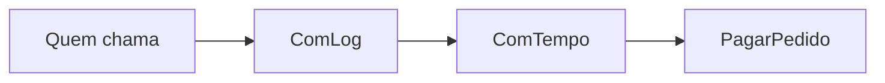

# Capítulo 22 — Embrulhando comportamento (Decorator)

!!! info "Situação da Empresa"

    Numa segunda-feira, o suporte recebeu três reclamações de "o site travou na hora de pagar". Ninguém conseguiu dizer se o pagamento demorou, se falhou ou se nem chegou ao sistema. Não havia registro de nada.

    O gerente fez dois pedidos: "Quero um log de cada operação: quando começou, se terminou bem ou se deu erro. E quero saber **quanto tempo** cada uma levou."

Esse pedido tem uma diferença importante em relação aos do capítulo anterior. Baixa de estoque e auditoria são **reações a um fato**. Log e medição de tempo não reagem a nada: eles acontecem **ao redor** de uma execução, antes dela, depois dela, e também quando ela falha.

---

## O problema, concretamente

O caminho mais curto é conhecido. Dentro de cada caso de uso:

```python title="O caminho curto" linenums="1" hl_lines="2-3 7 9-10"
    def executar(self, pedido_id, cliente, forma=FormaPagamento.PIX, **dados) -> None:
        print("PagarPedido: inicio")
        inicio = time.perf_counter()
        try:
            pedido = self._repositorio_pedido.obter(pedido_id)
            pedido.confirmar_pagamento(self._criador_pagamento, forma, **dados)
            self._repositorio_pedido.atualizar(pedido)
            self._barramento.publicar(PedidoPago(pedido, cliente))
        finally:
            print(f"PagarPedido: {(time.perf_counter() - inicio) * 1000:.1f} ms")
```

Nas outras três classes seria igual. O código de pagamento (quatro linhas) ficou enterrado entre código de medição, e o mesmo bloco precisa ser copiado, e mantido, em todos os casos de uso. Se amanhã o log passar a ir para um arquivo, são quatro arquivos para editar.

---

## 🧠 Pense

1. Por que um **evento** (Capítulo 21) não resolve este caso? Que partes do ciclo de vida de uma execução um evento `PedidoPago` consegue enxergar? E quais ele não enxerga?
2. Se o log pudesse ser **colocado em volta** de um caso de uso, como uma capa, o caso de uso precisaria saber que está coberto?

---

## A ideia: uma capa com o mesmo formato

Um evento só é publicado depois que o fato aconteceu: não vê o **início**, não vê a **falha**, não mede a **duração**. Para isso é preciso estar *entre* quem chama e o caso de uso.

!!! important "💡 Conceito — Decorator"

    O **Decorator** (decorador) é um padrão em que um objeto **embrulha** outro de **mesma interface**. Quem chama o embrulho acha que está falando com o objeto original. O decorador faz algo antes e/ou depois, e **delega** o trabalho de verdade ao objeto embrulhado.

    Como o decorador tem a mesma interface do que ele embrulha, ele pode ser embrulhado por outro decorador. É assim que as capas se **empilham**.



Os três têm um método `executar`. Quem chama `executar` no `ComLog` não sabe quantas capas existem nem o que há no centro.

Para dizer "mesma interface", damos nome ao formato comum dos casos de uso. É um `Protocol`, como a `FabricaNotificacao` do Capítulo 19:

```python title="ecommerce/aplicacao/caso_de_uso.py" linenums="1"
class CasoDeUso(Protocol):
    """O formato comum dos casos de uso: algo que se executa e devolve um resultado."""

    def executar(self, *args: Any, **kwargs: Any) -> Any:
        ...
```

---

## Os dois decoradores

O primeiro registra o início, o fim e a falha:

```python title="ecommerce/aplicacao/decoradores.py" linenums="1"
class ComLog:
    """Embrulha um caso de uso e registra quando ele comeca, termina ou falha."""

    def __init__(
        self, caso_de_uso: CasoDeUso, nome: str, registrar: Callable[[str], None]
    ) -> None:
        self._caso_de_uso = caso_de_uso
        self._nome = nome
        self._registrar = registrar

    def executar(self, *args: Any, **kwargs: Any) -> Any:
        self._registrar(f"{self._nome}: inicio")
        try:
            resultado = self._caso_de_uso.executar(*args, **kwargs)
        except Exception as erro:
            self._registrar(f"{self._nome}: falhou ({type(erro).__name__}: {erro})")
            raise
        self._registrar(f"{self._nome}: concluido")
        return resultado
```

Três detalhes fazem a diferença entre um decorador correto e um que causa dano:

- Os argumentos passam **intactos** (`*args, **kwargs`) e o **resultado** volta intacto. O decorador não pode alterar o contrato do que embrulha.
- Na falha, o erro é **relançado** (`raise`). Um decorador que engole a exceção esconderia do chamador que o caso de uso falhou.
- O decorador não conhece o caso de uso concreto: só o formato `CasoDeUso`.

O segundo mede o tempo:

```python title="ecommerce/aplicacao/decoradores.py" linenums="1"
class ComTempo:
    """Embrulha um caso de uso e registra quanto tempo ele levou, mesmo se falhar."""

    def __init__(
        self,
        caso_de_uso: CasoDeUso,
        nome: str,
        registrar: Callable[[str], None],
        relogio: Callable[[], float] = time.perf_counter,
    ) -> None:
        self._caso_de_uso = caso_de_uso
        self._nome = nome
        self._registrar = registrar
        self._relogio = relogio

    def executar(self, *args: Any, **kwargs: Any) -> Any:
        inicio = self._relogio()
        try:
            return self._caso_de_uso.executar(*args, **kwargs)
        finally:
            milissegundos = (self._relogio() - inicio) * 1000
            self._registrar(f"{self._nome}: {milissegundos:.1f} ms")
```

O `finally` garante a medição também quando há exceção, e o erro continua subindo. O **relógio** é injetado: por padrão é `time.perf_counter`, mas o teste passa um relógio falso, que devolve sempre os mesmos valores. Sem isso, o teste dependeria da velocidade da máquina. É a injeção de dependências do Módulo 4, aplicada a algo tão banal quanto o tempo.

`registrar` é só uma função que recebe um texto. Para a aplicação, "onde o log vai parar" é um detalhe de quem monta o sistema.

---

## Empilhando e montando

Na raiz de composição, um pequeno auxiliar embrulha o caso de uso com as duas capas:

```python title="ecommerce/composicao.py" linenums="1"
def _observado(caso_de_uso: CasoDeUso, nome: str, registrar: Callable[[str], None]) -> CasoDeUso:
    """Embrulha o caso de uso com log e medicao de tempo, sem que ele saiba."""
    return ComLog(ComTempo(caso_de_uso, nome, registrar), nome, registrar)
```

E `montar_aplicacao` passa cada caso de uso por ele:

```python title="ecommerce/composicao.py" linenums="1" hl_lines="1-4"
        pagar_pedido=_observado(
            PagarPedido(repositorio_pedido, CriadorPagamento(), barramento),
            "PagarPedido",
            registrar,
        ),
```

`PagarPedido` não mudou em uma linha. Quem usa `app.pagar_pedido.executar(...)` também não. O ganho apareceu na **montagem**. Rodando o fluxo completo, com o log configurado para mostrar mensagens informativas, o resultado é:

```text
PagarPedido: inicio
PagarPedido: 0.6 ms
PagarPedido: concluido
```

Repare na ordem: início, tempo, conclusão. O `ComLog` está por **fora**: ele escreve "início" antes de chamar o `ComTempo`, e "concluído" depois que o `ComTempo` terminou e registrou a duração. Se invertêssemos as capas, `ComTempo(ComLog(...))`, o tempo medido incluiria a escrita do log, e a linha de duração apareceria depois da conclusão. Dois testes fixam essa diferença:

```python title="tests/aplicacao/test_decoradores.py" linenums="1"
    # ComLog por fora, ComTempo por dentro
    assert linhas == ["Soma: inicio", "Soma: 250.0 ms", "Soma: concluido"]

    # ComTempo por fora, ComLog por dentro
    assert linhas == ["Soma: inicio", "Soma: concluido", "Soma: 250.0 ms"]
```

A **ordem do empilhamento é uma decisão**, e a montagem é o lugar onde ela fica visível.

!!! info "🏗️ Decisão de Projeto — decorador genérico ou um por caso de uso?"

    `ComLog` e `ComTempo` aceitam **qualquer** caso de uso porque usam `*args` e `**kwargs`. É isso que permite escrevê-los uma vez só. O custo é que o verificador de tipos não confere se os argumentos de `executar` batem com os do caso de uso embrulhado.

    A alternativa é um decorador por caso de uso, com a assinatura exata, como `PagarPedidoComLog`. É mais seguro e muito mais repetitivo. Para comportamento transversal, o genérico compensa. Se o decorador acrescentasse comportamento específico de um caso de uso, valeria o específico.

---

## Decorator, herança ou evento?

Agora há três formas de "acrescentar algo ao que um caso de uso faz". Cada uma serve a uma situação:

| | Evento (Cap. 21) | Decorator (este capítulo) | Herança |
|---|---|---|---|
| Quando atua | **Depois** do fato | **Antes, depois e durante** a execução | Dentro da própria classe |
| Vê a falha? | Não (só existe se houve sucesso) | Sim | Sim |
| Quem decide que acontece | Quem assina, na montagem | Quem monta, na montagem | A classe, no código |
| Dá para empilhar? | Sim, assinando mais manipuladores | Sim, embrulhando de novo | Mal: combinações viram subclasses |
| Exemplo | Baixa de estoque, auditoria | Log, medição de tempo, tentativa repetida | `PagarPedidoComLog(PagarPedido)` |

Uma regra de bolso:

- *"Quando X acontecer, faça Y"* → **evento**.
- *"Toda vez que X for executado, faça algo em volta"* → **decorator**.
- Herança, para isso, quase nunca: com três comportamentos transversais (log, tempo, repetição), seriam oito combinações possíveis de subclasses.

O mesmo vale para repositórios: um `RepositorioPedido` que registra cada consulta pode ser um decorador de `RepositorioPedido`, com a mesma interface, embrulhando o SQLite ou a memória. É o Exercício de Nível 2.

---

## Comando e evento: a intenção e o fato

O Capítulo 18 explicou que nossos casos de uso são *parentes* do padrão **Command**, mas que não carregam dados. Agora que existem eventos, a diferença fica nítida, porque comando e evento são **dois lados do mesmo acontecimento**:

| | Comando | Evento |
|---|---|---|
| Expressa | Uma **intenção**: "quero pagar o pedido 12" | Um **fato**: "o pedido 12 foi pago" |
| Nome | Imperativo: `PagarPedido` | Passado: `PedidoPago` |
| Tem destino | **Um** só: quem executa | **Zero, um ou vários** que assinam |
| Pode ser recusado | Sim: o pagamento pode falhar | Não: já aconteceu |
| Quem conhece quem | Quem envia conhece quem executa | Quem publica não conhece ninguém |

Um comando entra no sistema; um evento sai dele. O comando é o que o usuário quer; o evento é o que o sistema anuncia depois de decidir.

A forma fiel do padrão separaria os **dados** da **execução**. Não vamos refatorar o projeto para isso, mas vale ver como seria o `PagarPedido`:

```python title="Como seria a forma fiel (esboço)" linenums="1"
@dataclass(frozen=True)
class PagarPedidoComando:
    pedido_id: int
    cliente: Cliente
    forma: FormaPagamento = FormaPagamento.PIX


class PagarPedidoHandler:
    def __init__(self, repositorio_pedido, criador_pagamento, barramento) -> None: ...

    def executar(self, comando: PagarPedidoComando) -> None: ...
```

O comando é um objeto de dados, como um evento; o *handler* é o caso de uso, que recebe o comando em vez de parâmetros soltos. Há uma vantagem: todo handler passa a ter uma assinatura uniforme, `executar(comando)`, o que simplificaria decoradores como os deste capítulo. Para nosso sistema, o desenho atual, com parâmetros em `executar`, é suficiente. O importante é reconhecer o vocabulário quando ele aparecer em outros projetos.

---

## Testes

Cada decorador é testado com um caso de uso de mentira e uma lista no lugar do log:

```python title="tests/aplicacao/test_decoradores.py" linenums="1"
def test_registra_a_falha_e_relanca_o_erro(self) -> None:
    linhas: list[str] = []
    caso = ComLog(CasoQueFalha(), "Falha", linhas.append)
    with pytest.raises(ValueError):
        caso.executar()
    assert linhas == ["Falha: inicio", "Falha: falhou (ValueError: deu ruim)"]
```

E um relógio falso fixa a medição em números exatos:

```python title="tests/aplicacao/test_decoradores.py" linenums="1"
class RelogioFalso:
    """Devolve 1.0 na primeira leitura e 1.25 na segunda: 250 ms de diferenca."""

    def __init__(self) -> None:
        self._leituras = iter([1.0, 1.25])

    def __call__(self) -> float:
        return next(self._leituras)
```

No nível da montagem, o teste passa uma lista como `registrar` e confere que os casos de uso reais deixam linhas de log **sem saber disso**, inclusive quando falham:

```python title="tests/test_composicao.py" linenums="1"
    with pytest.raises(Exception):
        app.pagar_pedido.executar(99, maria)

    assert any(linha.startswith("PagarPedido: falhou") for linha in linhas)
```

```bash
$ pytest tests/
```

??? tip "204 testes passando"

    Os 196 do capítulo anterior continuam verdes. Entraram seis testes dos decoradores (início e fim, falha e relançamento, duração, duração com falha, e os dois empilhamentos) e dois de ponta a ponta na raiz de composição.

---

!!! warning "⚠️ Erro comum — o decorador que engole o erro"

    Um `except Exception: pass` dentro do decorador (ou um `except` que registra e não relança) transforma uma falha em sucesso silencioso. Quem chamou acha que o pagamento foi feito. O decorador **observa** a falha e a deixa passar.

!!! warning "⚠️ Erro comum — o decorador que muda o contrato"

    Se `ComLog.executar` devolvesse `None` em vez do resultado do caso de uso embrulhado, `DespacharPedido`, que devolve uma `Entrega`, quebraria só quando o log fosse ligado. O decorador precisa devolver exatamente o que recebeu.

!!! warning "⚠️ Erro comum — acessar o que o decorador não tem"

    O embrulho só tem o método `executar`. Um código que precisasse de algo próprio de `PagarPedido` (um atributo, um método auxiliar) e recebesse o decorador no lugar dele **não encontraria**. Se aparecer essa necessidade, o formato `CasoDeUso` está pequeno demais, ou a necessidade pertence a outro lugar.

---

## 🧩 Aplicando ao Projeto Financeiro

1. Crie o decorador `ComLog` (ou reaproveite a ideia) para os casos de uso do seu sistema financeiro, em especial `ImportarExtrato`, que costuma ser a operação mais lenta.
2. Empilhe com um `ComTempo` e escolha a ordem. Escreva o teste que mostra a diferença entre as duas ordens.
3. Faça a **auditoria de importações**: um decorador que registre quantos lançamentos foram importados. Ele precisa do resultado do caso de uso, não só do início e do fim. O que muda no decorador?

Documente: o que seu sistema financeiro passou a mostrar que antes ficava invisível?

---

## 🎯 Exercícios

**Nível 1.** Escreva um decorador `ComRepeticao(caso, tentativas)` que, se o caso de uso lançar uma exceção, tente de novo até `tentativas` vezes antes de desistir. Em que tipo de caso de uso isso seria perigoso? (Pense em `PagarPedido`.)

**Nível 2.** Crie `RepositorioPedidoComLog`, um decorador de `RepositorioPedido` com a mesma interface, que registre cada `obter` e `atualizar`. O que muda em relação ao decorador de caso de uso? Ele passa pela suíte de contrato do Capítulo 17?

**🚀 Desafio.** Refatore apenas o `DespacharPedido` para a forma comando + handler (`DespacharPedidoComando` e `DespacharPedidoHandler`). Quais arquivos mudaram? O que os decoradores deste capítulo ganharam ou perderam com essa mudança?

---

## 📌 Resumo

- Log e medição de tempo não são reações a um fato: acontecem **ao redor** da execução, inclusive quando ela falha
- O **Decorator** embrulha um objeto de mesma interface e delega a ele; as capas se empilham
- `CasoDeUso` é o formato comum (`executar`) que permite aos decoradores embrulhar qualquer caso de uso
- Um bom decorador repassa argumentos e resultado intactos e **relança** os erros
- A **ordem do empilhamento** importa e é decidida na raiz de composição
- *"Quando X acontecer, faça Y"* é evento; *"toda vez que X executar, faça algo em volta"* é decorator; herança quase nunca serve para isso
- Comando é a **intenção** (imperativo, um destino, pode ser recusado); evento é o **fato** (passado, vários interessados, já aconteceu)

## O que mudou no sistema

- ✔ Todo caso de uso deixa log de início, fim ou falha e o tempo que levou, sem ser editado
- ✔ O relógio é injetado, e o tempo é testável com valores exatos
- ✔ O vocabulário comando × evento está esclarecido
- ❌ Ainda não sabemos o que acontece quando **um manipulador de evento** falha: o erro sobe até quem chamou, e os seguintes não rodam

## O que vem a seguir

O sistema anuncia fatos, reage a eles e se deixa observar. Falta encarar o pior cenário que apareceu no Capítulo 20 e ficou como dívida: duas pessoas compram a **última** unidade, a segunda paga, e a baixa de estoque lança uma exceção. O pagamento está confirmado e guardado, mas o erro sobe para quem chamou, e a auditoria, que vinha depois, não rodou. O próximo capítulo trata de **reações que falham**, e fecha o módulo olhando para todos os padrões do curso.
