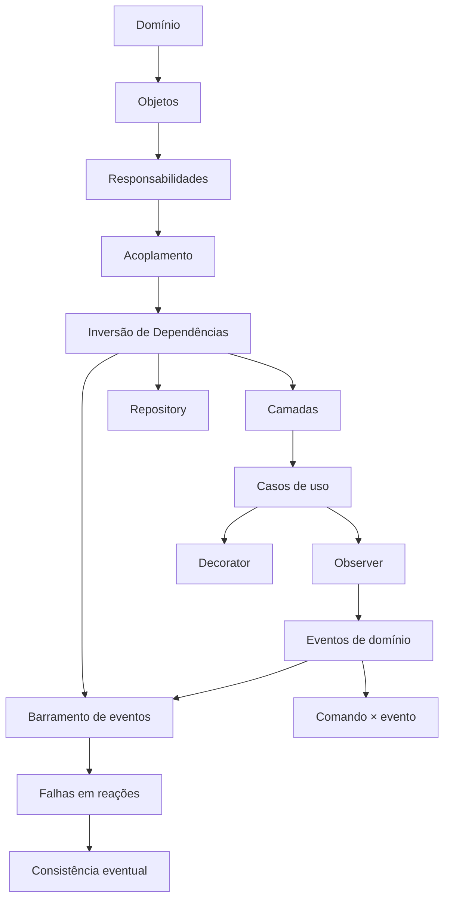

# Mapa de Conhecimento — Módulo 6

> **Do sistema organizado ao sistema que reage**

No Módulo 5, a pergunta era **quem pode conhecer quem**. No Módulo 6 ela ganha uma versão mais fina: **quem *causa* um acontecimento precisa conhecer quem *reage* a ele?** A resposta, ao longo dos quatro capítulos, foi que não.

## O que foi acrescentado

### Observer e eventos

- **Observer** — um objeto (o sujeito) mantém uma lista de observadores e os avisa quando algo acontece. O sujeito conhece apenas o contrato do observador.
- **Evento de domínio** — um objeto imutável que representa algo que **já aconteceu**, com nome no passado (`PedidoPago`). Carrega o que os interessados precisam saber.
- **Barramento de eventos (publish/subscribe)** — um intermediário entre quem publica e quem assina. Guarda as assinaturas e entrega cada evento a quem se inscreveu no seu tipo.
- **Manipulador (*handler*)** — quem reage a um evento. Em Python, uma função ou um objeto com `__call__`.

    ```
    PagarPedido
        ↓ publica PedidoPago
    BarramentoEventos  (porta, na aplicação)
        ↑ implementado por
    BarramentoEmMemoria  (adaptador, na infraestrutura)
        ↓ entrega a
    notificar · dar baixa no estoque · registrar auditoria
    ```

### Decorator

- **Decorator** — um objeto que embrulha outro **de mesma interface**, faz algo antes e/ou depois e delega o trabalho. Decoradores se empilham, e a **ordem do empilhamento** é uma decisão.
- **Comportamento transversal** — o que acontece *em volta* de várias operações (log, tempo, repetição), e não dentro de uma delas.
- **Decorator × evento × herança** — evento reage a um fato **depois** de consumado; decorator envolve uma execução inteira, inclusive a falha; herança, para isso, gera combinações demais.

### Comando e evento

| | Comando | Evento |
|---|---|---|
| Expressa | Uma intenção | Um fato |
| Nome | Imperativo (`PagarPedido`) | Passado (`PedidoPago`) |
| Destino | Um só | Zero, um ou vários |
| Pode ser recusado | Sim | Não |

### Falhas e consistência

- **Postura diante da falha** — propagar (a reação faz parte da operação), isolar e registrar (o fato já é verdade) ou repetir/compensar (precisa acontecer de qualquer jeito).
- **Consistência eventual** — por um tempo, as partes do sistema não concordam, e dependem de algo para voltarem a concordar.
- **Idempotência** — repetir o tratamento de um evento não pode ter efeito duplicado.
- **Atomicidade** — o que precisa acontecer junto, ou nada, pertence à mesma transação, e não a um evento.

### SOLID

O módulo reforça dois princípios:

- **SRP**: `PagarPedido` voltou a ter uma só razão para mudar, pagar.
- **OCP**: acrescentar uma reação, um log ou uma medição de tempo é **estender** o sistema pela montagem, sem editar o que já funciona.

### Padrões que "somem" em Python

Strategy, Observer, Command e Factory podem se reduzir a uma função ou a um objeto chamável. O Singleton é um alerta, e a raiz de composição entrega o que ele prometia sem a parte nociva.

## O mapa acumulado



## A pergunta central do módulo

> **Quem faz precisa conhecer quem reage?**

A resposta final do módulo é:

```text
Quem faz anuncia o que aconteceu, no passado.

                 ↓

Quem se importa assina, e é ligado numa montagem única.

                 ↓

O que precisa acontecer em volta (log, tempo) embrulha a operação,
sem entrar nela.
```

## Onde chegamos

```text
Módulo 1
Modelar conceitos e responsabilidades
        ↓
Módulo 2
Proteger estado e coordenar comportamentos
        ↓
Módulo 3
Isolar variações de comportamento
        ↓
Módulo 4
Isolar criação e montagem de dependências
        ↓
Módulo 5
Isolar o domínio dos detalhes técnicos
        ↓
Módulo 6
Isolar quem faz de quem reage
```

O sistema agora tem uma estrutura que diz o que é cada coisa, uma regra verificada sobre quem depende de quem, e um mecanismo para crescer **por adição**: reações, log e medição entram pela montagem, sem abrir o que já existe. É o encerramento do percurso do curso, e o ponto de partida para a [entrega final](entrega.md).
